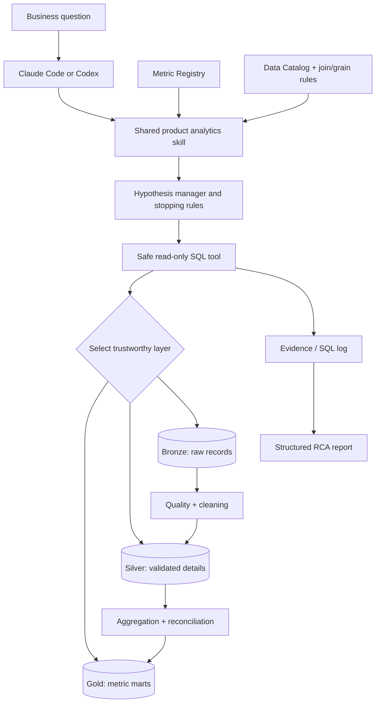

# Architecture v1.0 — Frozen design baseline

**Frozen:** 2026-11-07  
**State:** Approved design; not yet implemented or evaluated.  
**Project:** LLM-agnostic, evidence-first product analytics agent.

## Goals
1. Answer open-ended business questions through multi-step, SQL-backed root-cause investigation.
2. Allow Claude Code and Codex to run the **same shared skill, metric rules, data catalog and query tools**.
3. Guarantee metric reproducibility where possible; do **not** promise identical reasoning or wording across LLMs.
4. Use logical Bronze → Silver → Gold data layers to balance correctness, auditability and efficiency.
5. Produce traceable evidence, quantified drivers, explicit uncertainty and actionable recommendations.
6. Eventually offer a visual web workbench without coupling it to the agent's core logic.

## System flow

## Logical warehouse
Initial storage is **one SQLite database** with table prefixes `bronze_`, `silver_`, `gold_`, not three separate database servers.

- **Bronze:** Original synthetic source records, preserved with deliberate quality issues. Planned domains: users, sessions, content views, transactions, content catalog, marketing spend.
- **Silver:** Clean, validated, deduplicated facts and dimensions with reproducible transformations, exception handling and lineage.
- **Gold:** A small number of useful precomputed business KPI marts, with documented refresh, grain, filters and supported aggregations.

**Routing policy:** Gold first only when it correctly supports requested dimensions, time frame and measure; Silver for detailed investigations; Bronze for reconciliation and raw data-quality audit. A faster but incorrect Gold answer is never acceptable. Never sum overlapping distinct users or join many-to-many facts without addressing fanout.

## Metric Registry — common analytical semantics
Every metric definition must provide: name; business meaning; numerator and denominator; eligible user/event population; grain; time zone and cohort eligibility; source layers/tables; canonical calculation/SQL; supported filters; null, refund and status rules; aggregation safety; expected data-quality checks; definition version. Examples to define: MAU, DAU, net revenue, subscription and PPV revenue, ARPU, conversion, churn, retention, watch time and episode completion. **Exact definitions are not yet frozen.**

## Data Catalog — table knowledge
Each table must document: layer, purpose, row grain, columns, keys, supported joins/cardinality, time field, source lineage, refresh/freshness, quality constraints, known caveats and example use. The agent must not guess join relationships.

## Investigation policy
1. Parse question; clarify material ambiguities or state defensible assumptions.
2. Validate metric definitions, coverage, freshness and important data-quality issues; calculate baseline and decompositions.
3. Form **up to three distinct, evidence-informed hypotheses** per round, ranked by relevance/diagnostic value; do not invent percentage probabilities.
4. Execute bounded read-only SQL, interpret results and record statuses **Supported, Rejected, Inconclusive, Not Tested**, with evidence links.
5. Continue for **at most three autonomous rounds**, hence at most nine distinct hypotheses, unless an early stop is justified.
6. Stop early once material drivers are adequately quantified; also stop/qualify on critical data-quality failures, exhaustion of query/time limits or repeated dead ends.
7. If unresolved after three rounds, show partial findings, rejected avenues and unknowns; invite a **user-proposed hypothesis** or direction. A user may intervene at any time.
8. Default to autonomous RCA; optional guided mode lets users choose hypotheses.
9. Never manufacture a root cause or assert causation merely from observational association.

## Query execution, safety and audit
A shared Python/SQLite query interface will enforce read-only access, query validation, resource/time and result-size limits, logged SQL, errors and retry control. Evidence records should include question, snapshot/seed, metric definition version, source layer, SQL, duration, result summary, hypothesis status, analytical caveats and decision. Silver/Gold transformations require data-quality and reconciliation checks; show Bronze-versus-trusted discrepancies.

## Output contract
Executive summary; question and metric definitions; comparison period and data coverage; numerical KPI changes; segment/cohort decomposition; hypothesis ledger and query evidence; quantified drivers with explicit assumptions; recommendations and validation plans; uncertainties and unresolved questions. A raw SQL table alone is not a completed investigation.

## Evaluation
At least 15 test questions covering aggregates, filters, time comparisons, retention/cohorts, joins, data-quality traps, ambiguity and unanswerable questions. Store expected numeric outputs separately, use fixed-seed data snapshots, record failures, query counts, latency, evidence quality and Claude/Codex numerical agreement. A **design baseline** has no performance results yet.

## Visual documentation and future workbench
Phase 1: Finder/Explorer-like repo tree, data flow, architecture versions, metric browser and how-it-works guides. Phase 2: secure chat and provider integration through controlled execution backend; static HTML must never contain API keys or unrestricted access to SQLite/private repo. Architecture and runtime should remain separable.

## Risks and open implementation decisions
Metric definitions; data schema/grains and business mechanisms; Gold snapshot freshness and reconciliation; query budget defaults; cross-runtime tools/permissions; secure reviewer execution; supporting a future public UI. The initial version must stay deliberately minimal, despite production-inspired structure.

## Versioning rule
**Do not rewrite this frozen baseline when changing architecture.** Record changed decisions in ADRs, document evaluation evidence, and create a new versioned blueprint (e.g. `v2.md`). The project is private initially; confidential business assignments and materials must be excluded from any public release and its Git history.
