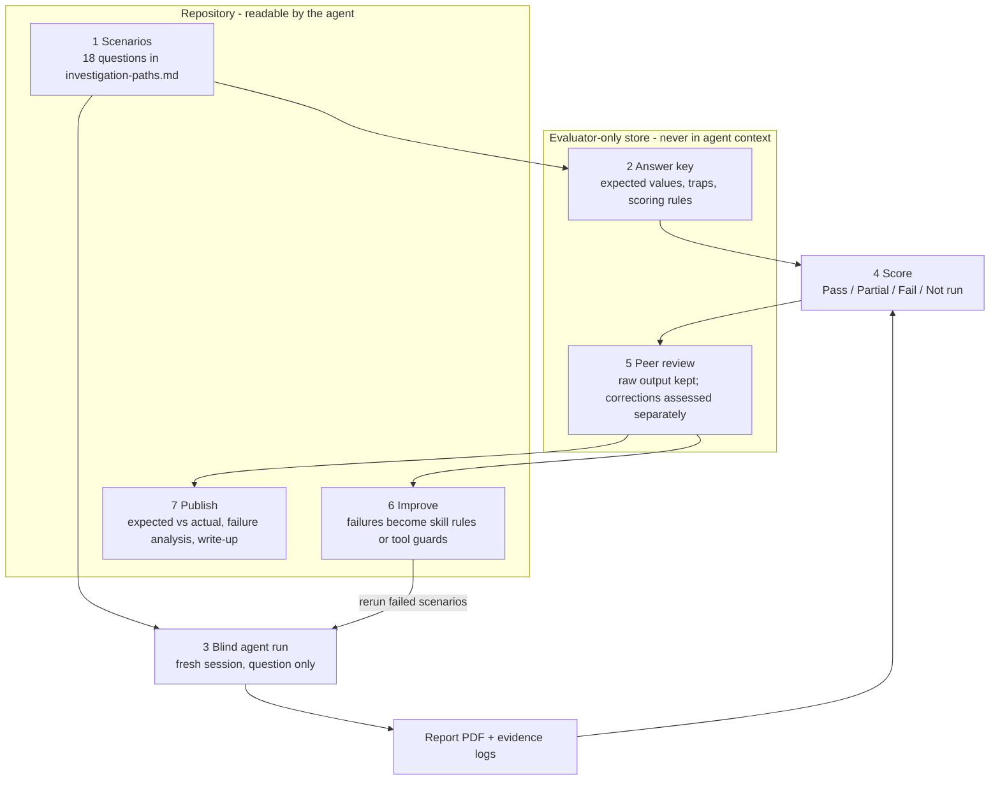

# Evaluation process

**Status:** Round 1 (18 scenarios) and round 2 (4 reruns) complete. [Results](results.md); answer key and scored runs in [`evaluation-results/`](../../evaluation-results/), published after the blind runs.
**Scope:** How the analytics agent is evaluated on the PocketToons fixture, in Claude Code and Codex, using the shared investigation skill.

The evaluation checks whether the agent answers product questions correctly, with traceable evidence and honest uncertainty. It compares each agent run against an answer key written **before** the run, from the source data, by a method independent of the agent's own pipeline.

## Workflow

1. **Scenarios.** [`investigation-paths.md`](investigation-paths.md) defines 18 questions: aggregates, filtered queries, comparisons, cohorts, multi-step investigations, data-quality traps, an ambiguous request (expects a clarifying question) and an unanswerable one (expects a clear decline). It describes routes and success criteria; it is not an answer key.
2. **Answer key.** For each scenario that has numbers, the evaluator records the expected values, the traps a good answer must report and the behaviour that fails. The values come from the metric registry's canonical SQL run **read-only on the source tables only**, never on the Silver or Gold tables the agent uses, so the key does not repeat the agent's pipeline. Every reference query is logged. The key is reviewed and approved in small topic groups (activity; revenue and lifecycle; content and data quality). Behaviour-only scenarios use their success criteria directly.
3. **Blind agent run.** Each scenario runs in a **fresh** session (one runtime per scenario in this evaluation) that receives only the question, the database path and "independent mode". The agent follows the [shared investigation skill](../../skills/product-analytics-investigation/SKILL.md): read-only queries through [`tools/evidence_query.py`](../../tools/INVESTIGATION.md), one evidence log per query, and for a requested report a PDF built with `tools/report_pdf.py` (at most 10 pages).
4. **Score.** The evaluator compares the run with the answer key using the outcome rules in the [evaluation run template](evaluation-run-template.md) and records the result. Numbers and behaviour both count: a run with correct numbers still fails if it claims a cause from an association, mislabels comparison periods or skips a material data-quality caveat.
5. **Peer review.** A reviewer checks the report against the evidence and the source data. The raw agent output is kept unchanged. A corrected version may be produced for the deliverable, but it is assessed separately and never turns a failed run into a pass.
6. **Improve.** Each failure type becomes a rule in the shared skill or a guard in the tools (for example, the 10-page limit in the report generator). Failed scenarios are rerun in new sessions to confirm the fix.
7. **Publish.** After the blind runs, the expected-versus-actual results, failure analysis and write-up are added to the repository for reviewers.

## Scoring rules

These rules are fixed before any run and apply to every scenario:

- **Counts and money:** exact match. **Rates and percentages:** ±0.1 percentage point (rounding only). **Averages:** ±0.1.
- **Unstated choices:** when a question does not name a comparison period, measure or meaning, a clearly stated, defensible choice passes, and so does a short clarifying question. A silent or mixed choice fails.
- **Certainty:** an unsupported claim of certainty fails, for example a cause from an association, a hypothesis rejected without evidence, or a data-quality effect called negligible without measurement.
- **Outcomes:** Pass, Partial, Fail or Not run, as defined in the run template. A not-run scenario is never counted as a pass.

## Independence rules

- The answer key, run records and reference query logs are **evaluator-only**. Before blind runs they were kept outside the repository. The published copies in this repository must be excluded from an independent investigation session and never supplied in an agent prompt.
- Being outside the repository does not by itself hide a file from an agent with local file access. Keep the evaluator store away from agent working folders, and out of the session entirely during a run.
- A session that has seen the answer key, a scenario's findings or [`investigation-paths.md`](investigation-paths.md) cannot be used for an independent run. Runs given the scenario guide are labelled **guided** and reported separately.
- Scenario IDs (Q01–Q18) follow [`investigation-paths.md`](investigation-paths.md). Evidence file names such as `q01` are query IDs within a run, not scenario IDs.

## Where things live

| Item | Location | Why |
|---|---|---|
| Scenarios, skill, tools, report generator, templates, this process | This repository | Shared by both agent runtimes; readable by the agent |
| Answer key, reference query logs, run records, raw and corrected reports, peer-review notes | Published in `evaluation-results/` after the blind runs; exclude from independent agent sessions | Keeps expected answers out of the agent's context during blind runs |
| Published results and write-up | This repository, after the blind runs | Lets reviewers see expected vs actual once independence no longer matters |

## Related files

- [Investigation paths and scenarios](investigation-paths.md)
- [Evaluation run template](evaluation-run-template.md)
- [Investigation report template](../deliverables/investigation-report-template.md)
- [Project status](../project-status.md)

