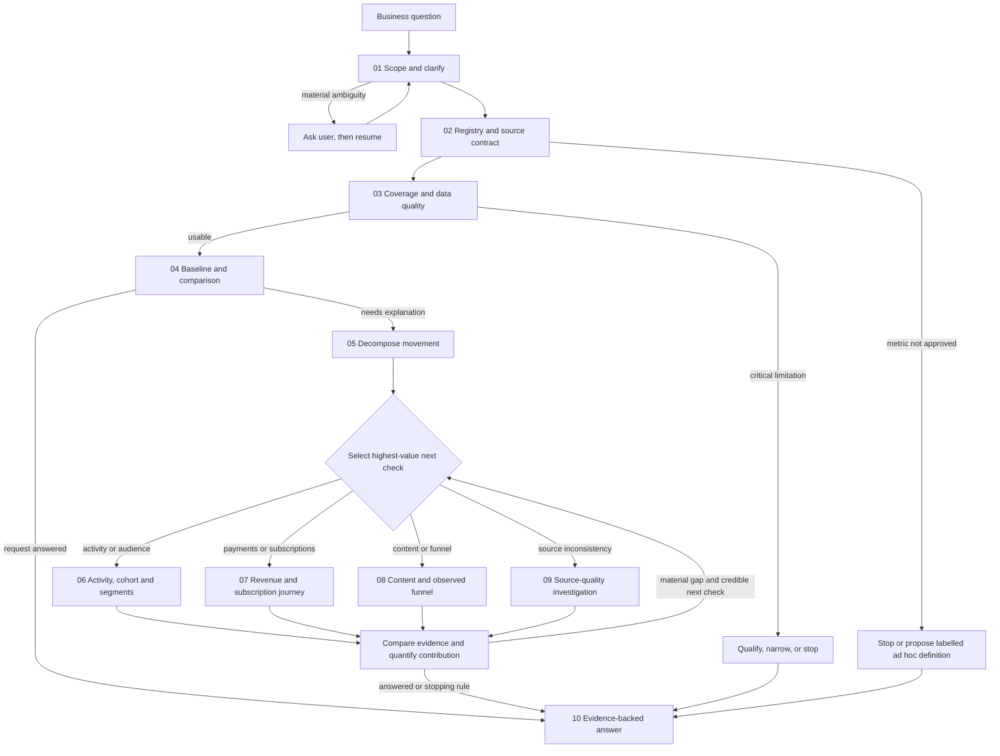

# Investigation paths and evaluation questions

**Status:** Design for the evaluation stage. The paths and 18 scenarios are defined; they have not yet been run as an evaluation suite, and the agent is not yet evaluated end to end.  
**Scope:** The shared, model-neutral analytics workflow, using the PocketToons fixture as an example.  
**Authoritative definitions:** [Metric Registry](../metrics/metric-registry.md), [Data Catalog](../examples/pockettoons-data-catalog.md), [reference data model](../examples/pockettoons-reference-data-model-v1.md), and [Architecture v1](../architecture/v1.md). Recheck their current versions before using a path.

## Purpose and boundaries

The question catalog below links business questions to reusable investigation steps, source data and observable success criteria. The graph is a navigation design, not a fixed list of conclusions. A path may branch, return to an earlier check or stop when evidence is insufficient.

Every metric in the registry's metric map is approved; a request outside it is answered as a labelled ad hoc variant, not by inventing a denominator, period, population, status rules or SQL. An approved metric must be used with its current version. The fixture tables named here exist, and Bronze, Silver and Gold tables are built from them: the [Gold question list](../data-layers/pockettoons-gold-questions.md) maps each scenario to the Gold table that answers it, and the [layer contracts](../data-layers/pockettoons-layer-contracts.md) state each table's grain, rules and limits. Confirm a layer's build record and contract before relying on it; follow the catalog's grain, identity and temporal rules when working from source tables.

This document is not an answer key. Independently verified expected numbers and deliberately hidden evaluation cases belong in a separate evaluator-only artifact, outside the agent's investigation context. Giving the agent this question-specific playbook during a test measures guided navigation, not independent discovery; evaluate both modes separately.

## Connected investigation graph

### How to navigate efficiently

1. **Start from the decision, not a table.** Identify the metric, comparison, population and requested output. Ask a targeted question when an ambiguity could materially change the answer.
2. **Reuse approved definitions and evidence.** Fetch the current registry and catalog entry. Reuse a result only when its metric version, filters, period, source and data snapshot match. A CTE, grouped query or shared baseline can answer multiple compatible checks.
3. **Check trust before explaining movement.** Verify the relevant time coverage and quality constraints before using a figure. Compare Gold only when its grain, dimensions, freshness and reconciliation are proven; otherwise use supported detail, or source evidence for an audit. The fixture currently uses its documented tables, not implemented medallion layers.
4. **Choose the next check by expected usefulness, not an invented probability.** Prefer a check that can distinguish competing explanations, covers a material part of the movement, uses reliable data and can be safely batched. Record why it was chosen. Estimated usefulness is a heuristic: no design can guarantee the fewest queries or the best possible answer.
5. **Follow the evidence.** If a branch adds no material information, is unsupported, or fails a quality gate, stop that branch and record the reason. Return to node 05 when a finding changes the next hypothesis. Do not use future knowledge or a question-specific answer key.
6. **Stop honestly.** Return when the requested answer is adequately supported, the remaining uncertainty is clearly bounded, or a stopping condition is reached. Architecture v1 allows up to three distinct hypotheses per round, for at most three automatic rounds; stop earlier where justified. Also stop or escalate for material quality failures, budget/time limits or exhausted credible hypotheses. Ask the user for direction when needed.
7. **Confidence is earned, not assigned by query count.** More checks do not automatically mean more confidence. Use coverage, reconciliation, independent corroboration, sensitivity to missing data, temporal alignment and alternative explanations. Never claim causal proof from association alone.

## Reusable check nodes

The `Next` field is a routing guide; not every question needs every node. “Query” means a future bounded, read-only operation, not an existing agent tool.

| ID | Check and inputs | Where to look | Decision / next |
|---|---|---|---|
| 01 | Clarify metric, period, baseline, timezone, population and business decision. Record assumptions. | User request; registry names and catalog coverage. | Ask if a material choice is missing; otherwise 02. |
| 02 | Retrieve approved metric version, SQL, eligible population, supported dimensions, layer and join rules. | Registry; catalog; metadata. | Approved and supported → 03. Unapproved or incompatible → ask/hold or explicitly labelled ad hoc only if appropriate. |
| 03 | Check available dates, completeness, freshness where known, unknown attribution, data-quality warnings and relevant join cardinality. | `dataset_metadata`, relevant source tables and checker; source-specific quality evidence. | Critical gap → qualify or stop. Otherwise 04. Quality checks and fixture flags are not proof of real-world completeness. |
| 04 | Compute comparable baseline and requested metric with correct period and grain. Batch compatible slices. | Approved registry SQL and its listed fixture tables; relevant status history. | If sufficient → 10; otherwise 05. |
| 05 | Quantify the movement and decompose it into compatible, non-overlapping components. Avoid summing overlapping distinct-user slices. | Baseline result; catalog-approved keys and time semantics. | Rank 06–09 by materiality, coverage, cost and ability to distinguish explanations. |
| 06 | Examine active/engaged users, cohorts and meaningful slices; report unknown/unidentified coverage and sensitivity. | `sessions`, `identity_links`, `users`, `content_views`, `playback_segments`; registry. | Quantify supported contribution, test overlap and comparability → 05 or 10. |
| 07 | Trace payments, refunds and subscription state, using effective history rather than current snapshots for historical questions. | `transactions`, `payment_status_history`, `subscription_history`; relevant attribution tables. | Reconcile at transaction grain, apply approved metric/status rules → 05, 09 or 10. |
| 08 | Trace content use or a captured funnel. Match actual foreign keys and time windows; preserve unlinked cases. | `content_views`, `playback_segments`, `content_episodes`, `content_tier_history`, `content_availability_history`, `user_events`, `transactions`. | Separate observed links from inferred or causal relationships → 05 or 10. |
| 09 | Examine raw values, review evidence and curated records without changing source data. | `raw_payment_source`, `payment_quality_review`, `transactions`; `users.acquisition_source`. | Explain affected scope, unresolved records and correction timing → 04, 05 or 10. A review record is not proof of independent detection. |
| 10 | Return answer, evidence/SQL, source and version, coverage, quantified contributions, uncertainty and next action. | Evidence from prior nodes. | Mark supported, rejected, inconclusive or not tested; escalate unresolved material gaps. |

## Data and join map

| Investigation | Starting grain and links | Important safeguard |
|---|---|---|
| Activity and signups | `sessions.session_id`; resolve user from `sessions.user_id` or the registry's eligible same-session `identity_links`; `users.user_id` supplies user attributes. | Anonymous device IDs are not people. Do not claim another session by device ID. Active/engaged rules, period boundaries and unidentified sessions come from the approved metric. |
| Watching and content | `content_views.view_id` → `playback_segments.view_id`; (`content_id`, `episode_number`) → `content_episodes`; availability/tier history by episode and relevant timestamp. | A view can have many segments; don't multiply views. Merge overlapping watched ranges for unique coverage when required. Historical tier and availability require as-of intervals. |
| Payments and refunds | `transactions.txn_id` → `payment_status_history.txn_id`; a refund's `related_txn_id` points to the original transaction. Content allocations use the corresponding attribution table. | Pick the approved success-effective time and status semantics. Refund amounts are positive; subtract qualifying refunds in a net calculation. Aggregate each fact before joining many-side tables. |
| Subscription access | `subscription_history.user_id` and `subscription_id`, matched at the event instant within effective intervals; `source_txn_id` links the purchase when populated. | Current `users.subscription_status` is a snapshot, not historical state; cancellation at period end is not immediate loss of access. |
| Paywall, checkout and payment | `user_events.triggering_paywall_event_id` → paywall event; `transactions.checkout_event_id` → checkout event; session and episode keys provide context. | Both links can be missing; do not infer a captured link from nearest event or force a single payment attempt per checkout. Exposure does not establish causality. |
| Marketing comparison | Aggregate `marketing_spend` to UTC day/channel and signups from `users.signup_date`/`acquisition_source` independently, then compare. | Do not join a spend row directly to many users and sum it. Preserve unknown and unmatched groups. Same-day spend is not proof of the exposure that caused a signup. |
| Payment quality | `raw_payment_source.txn_id` and optional `payment_quality_review.txn_id` → `transactions.txn_id`. | Raw data is not an extra payment. Do not silently divide outliers or cast invalid text. NULL `reviewed_at` makes historical review availability unknown. |

## Question catalog: 18 evaluation scenarios

Each flow is a candidate route. Branch choices depend on the question and observed evidence, not a preset answer. The metric names below are capabilities to resolve in the registry at execution time; “definition needed” means stop or clarify until an approved definition exists.

| ID | User question | Candidate flow | What success requires |
|---|---|---|---|
| Q01 | How did monthly active users change across the available months? | 01 → 02 → 03 → 04 → 10; approved `mau`; sessions and same-session identity resolution. | Complete UTC months, distinct users, unidentified sessions and metric version; no summing monthly users. |
| Q02 | Why did active users grow while revenue stayed relatively flat? | 01–05 → 06 and 07 → 09 if quality warrants → 10; `mau` plus an approved net-revenue definition. | Verify both baselines, quantify compatible components, test high-value branches and report unexplained movement; no forced cause. **Definition needed:** net revenue if not approved at execution. |
| Q03 | Which acquisition sources contributed most to the change in active users? | 01–05 → 06 → 09 if unknown sources are material → 10; sessions, users and approved `mau`. | Use first-touch source and fixed user-level slices; show unknown separately and sensitivity where relevant. Don't claim advertising caused the change. |
| Q04 | Did engaged users grow with active users? | 01–04 → 06 → 10; current approved activity/engagement metrics; sessions, views and segments. | Apply the approved watch threshold and allocation rules; use complete comparable periods and distinguish activity from engagement. |
| Q05 | Did the platform mix change? | 01–05 → 06 → 10; platform slice of the approved active-user metric. | Identify overlapping users across platforms; total comes from an unsliced distinct count, not a sum of platform MAUs. |
| Q06 | Are more users new, retained or returning? | 01–04 → 06 → 10; use approved monthly growth accounting and its documented history coverage. | Reconcile components using its registry rules; flag missing prior observation and avoid calling a returning classification causal. |
| Q07 | Did newer signup cohorts convert to subscription at a lower rate? | 01–03 → 06 → 07 → 10; users, subscription purchases and payment history. | Compare equally long, fully observed cohort windows and eligible populations. **Definition needed:** subscription conversion if not approved. |
| Q08 | How much net revenue came from subscriptions versus PPV? | 01–04 → 07 → 09 if an anomaly appears → 10; transactions and payment history. | Use approved status/time and refund allocation rules, reconcile components once per transaction, and distinguish gross from net. **Definitions needed** if not approved. |
| Q09 | Did refunds materially change the revenue comparison? | 01–04 → 07 → 10; refund transactions and original-purchase links; attribution where needed. | Subtract qualifying positive refund amounts, use success-effective timing and avoid counting pending or failed refunds. **Definition needed:** net revenue/refund rate if requested. |
| Q10 | How many subscription cancellations took effect during a period? | 01–03 → 07 → 10; subscription history and relevant payment history. | Clarify cancellation request versus end of entitlement; use effective intervals, not the current user snapshot. **Definition needed:** cancellation/churn metric. |
| Q11 | Where do users drop from viewing a paywall to starting checkout and purchasing? | 01–03 → 08 → 07 → 10; user events and captured transaction checkout links. | Agree on funnel unit, window and denominator; report missing links and retries. Do not infer causal exposure or count one checkout once per attempt. **Definition needed:** funnel conversion. |
| Q12 | Which episodes are watched most, and how much is actually completed? | 01–03 → 08 → 10; views, segments and episodes. | Agree on view/user grain and completion definition; avoid segment fanout and account for rewatches and coverage. **Definition needed:** ranking/completion metrics. |
| Q13 | Is an unusually large source payment real? | 01 → 03 → 09 → 07 if financial impact matters → 10; raw source, review and transaction. | Show raw value/unit and evidence separately, measure impact and uncertainty; never automatically divide by 100. Existing review is not independent discovery. |
| Q14 | Can we trust acquisition-channel conclusions when source values are missing? | 01–04 → 09 → 06 → 10; users and sessions; marketing only if requested. | Report unknown group and perform an appropriate sensitivity analysis. Separate same-day spend comparison from individual attribution. |
| Q15 | “Performance is down. What happened?” | 01 → ask → 02; resume only after meaningful scope is known or an assumption is explicitly accepted. | Ask a concise clarification about metric/timeframe rather than silently picking a definition or pretending the answer is complete. |
| Q16 | Which advertising campaign caused each user's purchase? | 01–03 → 08/09 only where useful → 10. | State that campaign-level user exposures and causal attribution are not available; explain what can be compared and what data would be needed. Do not fabricate a join or causal claim. |
| Q17 | How many US users had an active subscription at the end of September? | 01–03 → 07 → 10; subscription history and users; approved `active_subscribers` snapshot sliced by user country. | State the snapshot instant; count every user with subscription access at that instant, including cancelled subscriptions still paid up, or say clearly that a narrower definition is used; slice by the user's country. |
| Q18 | How many mobile sessions were there in September versus August? | 01–03 → 04 → 10; sessions and identity links; session counts sliced by platform. | Define "mobile" from the platform values and say what is excluded; count sessions the same way (all or identified) in both months; note that the months have different lengths. |

## Evaluation contract

For each scenario, the future evaluation record should contain: question and variant; fixed dataset snapshot and coverage; metric IDs/versions and parameters; prerequisites and current status; allowed inputs; hidden independently verified expected outputs where meaningful; required checks and safeguards; acceptable stopping or clarification behavior; SQL/evidence; result and limitations; and pass/fail rationale.

Assess at least:

- **Correctness:** correct approved metric, population, time, status, grain and numerics; reconcile totals where applicable.
- **Data quality:** surface relevant unknowns, errors and coverage; distinguish evidence of review from independent detection.
- **Navigation:** take a relevant sequence, reuse compatible checks, avoid redundant queries and stop or escalate appropriately. Log query count, time and failures; compare paths on matched cases rather than assuming an optimal count.
- **Safety and honesty:** bounded read-only queries, no invented joins or causes, uncertainty and unsupported requests clearly stated.
- **Traceability:** metric version, SQL, time window, source tables/layer, snapshot, results and limitations are available.

Before implementation, turn each approved scenario into a reproducible test with an independently validated oracle where feasible. Include boundary cases and held-out questions so the agent is not rewarded merely for following memorized paths. Record “not testable yet” when required metric definitions, data layers or agent capabilities do not exist.
