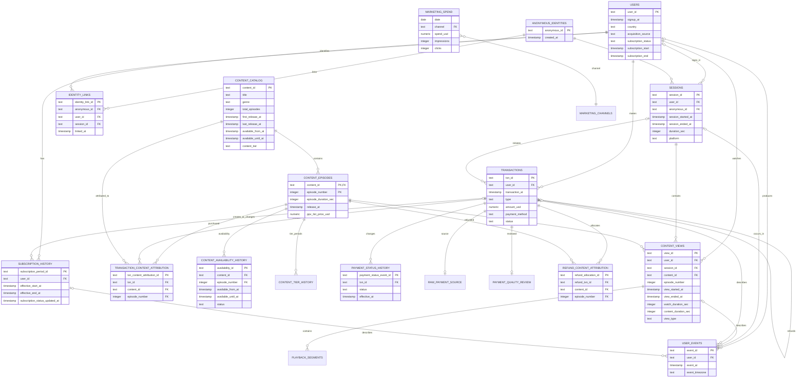

# PocketToons Reference Data Model v1 — Step 2A

## 1. PocketToons context

PocketToons is the fictional anime-streaming product in the interview assignment. It uses a freemium model: every user can start up to eight distinct free-tier episodes per UTC calendar day; premium episodes require a subscription or PPV; a $9.99 monthly subscription unlocks all content; and users can also buy individual premium episodes through pay-per-view (PPV). The assignment asks for six months of synthetic data and an analytics agent that can investigate questions such as: **MAU is up 20% quarter-over-quarter, but revenue is flat—why?**

This document defines the PocketToons dataset contract: the six assignment tables and fields, supporting relationships, user journeys, synthetic-data requirements, and validation rules.

PocketToons is an assignment-specific reference dataset within the generalized product-analytics-agent repository. Shared agent architecture and analytics conventions are documented separately.

## 2. Design decisions

The model must preserve both the *business state* (current subscription) and the *history that created it* (events, subscription periods, transactions, and watched episodes).

The six assignment tables and their required fields are retained exactly, with additive fields where necessary. `users.subscription_status`, `subscription_start`, and `subscription_end` are a convenient current-state snapshot; `subscription_history` is authoritative for historical/as-of entitlement. Likewise, `content_views` is a view fact rather than a session summary, and `session_id` makes every in-app view joinable to the session in which it occurred.

### Entity relationship diagram

The diagram is a relationship overview, not an exhaustive column list; the column-level schema is the complete reference. The diagram shows important UTC timestamps. Assignment-required date columns are derived from these timestamps and are listed in the column-level schema; they need not be separately captured in the raw layer. Daily marketing spend is an exception: its source is already a daily aggregate, so its reporting date describes the whole period and cannot provide a true event time.



`MARKETING_CHANNELS` is a controlled-value reference, shown only to make the `marketing_spend.channel` relationship explicit. It is optional in an initial SQLite build; a checked enum can enforce the same contract.

## 3. Canonical keys, time, and access rules

### IDs and timestamps

| Business occurrence | Authoritative UTC timestamp | Assignment-required derived date |
|---|---|---|
| User signup | `users.signup_at` | `users.signup_date` |
| Session | `sessions.session_started_at` and `session_ended_at` | `sessions.date` from start |
| Content view | `content_views.view_started_at` and `view_ended_at` | `content_views.date` from start |
| Transaction | `transactions.transaction_at` | `transactions.date` |
| Series release | `content_catalog.first_release_at` | `content_catalog.release_date` |
| Episode release | `content_episodes.release_at` | No separate date required |


- IDs are immutable opaque strings (for example, UUIDs); do not infer a timestamp, country, or source from an ID.
- Store all event timestamps in UTC as ISO-8601 timestamps. Assignment-mandated `date` fields are UTC calendar dates derived from the canonical timestamp, retained for simple daily analysis.
- The v1 free quota resets at 00:00 UTC for everyone. This is a chosen product rule for the synthetic case; it means the reset occurs at different local clock times. Event timezone is retained as context for later local-time analysis, not used to calculate this quota.
- Assignment-required date fields are derived compatibility fields (for example, exposed in a view); they are not separately captured in the raw layer. Raw event timestamps remain the source of truth. A daily marketing report retains its source reporting date and must be explicitly normalized to UTC only if its source supports it.
- `users` is one row per user. Facts are append-only except for documented correction fields; no facts are overwritten to represent a new business event.

### Entitlement precedence at a view start

Playback requires an authenticated account. If a visitor is not logged in, record a login-required event and create no content view. After login, verify the episode is live, then apply the first matching rule:

1. An active subscription unlocks all episodes (`view_type = 'sub'`).
2. Otherwise, a valid PPV purchase unlocks that premium episode (`'ppv'`).
3. Otherwise, a free-tier episode is `'free'` if it already consumed a slot for this user today, or fewer than eight distinct free-tier episodes have consumed slots today across all devices. A retry or resume of a counted episode is allowed even when all slots are used.
4. Premium playback without subscription or PPV is blocked, regardless of free slots. A new free-tier episode is blocked after eight slots. Record blocked attempts as `playback_blocked` events.

The quota is keyed to `user_id` across all devices and sessions, resetting at 00:00 UTC. Anonymous browsing consumes no quota because anonymous playback is not allowed. Retries of the same free-tier episode on the same UTC day consume no additional slot. Separate accounts have separate quotas; account sharing or creation of multiple accounts is outside this rule.

Active subscribers pay no PPV charge for viewing. A PPV purchase remains valid if the user later subscribes; no automatic credit is assumed. Delisting ends the entitlement permanently at the delisting time; after relisting the user must buy it again. A prior delisting warning is a separate event. A refund request is an event; a succeeded refund creates a linked positive-amount refund transaction. For PPV, partial episode refunds retain access; cumulative succeeded allocations reaching the full episode purchase allocation end that episode's entitlement at the success time of the final refund, if still active. Subscription refunds end the relevant subscription access. A denied refund leaves access unchanged. Views already recorded are retained.

The stored `content_views.view_type` records the decision at view start and is never retroactively relabelled by a later cancellation/refund or tier change. If an episode changes from free to premium during an already-authorized playback attempt, the attempt may continue. A later new start or resume requires a fresh access decision using the tier and entitlement at that new start. Recalculated “as-of” access must use the history tables below.

## 4. Column-level schema and grain

### 4.1 `users` — assignment-mandated

**Grain:** one row per registered user. **Primary key:** `user_id`.

| Column | Type | Null? | Definition / rule |
|---|---|---:|---|
| `user_id` | TEXT | no | Immutable primary key. |
| `signup_date` | DATE | no | Assignment-required UTC date derived from `signup_at`. |
| `signup_at` | TIMESTAMP | no | UTC account-creation timestamp. |
| `country` | TEXT | no | Required assignment field: current country, or `unknown` when unavailable. |
| `country_origin` | TEXT | yes | ISO country at signup if known, not nationality. |
| `country_current` | TEXT | yes | Current profile country if known; agrees with `country` or NULL when unknown. |
| `acquisition_source` | TEXT | no | First-touch channel (`organic`, `paid_search`, `paid_social`, `creator`, `referral`, `other`, `unknown`). `unknown` represents missing attribution, not an acquisition channel. |
| `subscription_status` | TEXT | no | Current snapshot: `never_subscribed`, `active`, `cancel_at_period_end`, `expired`, `refunded`, `paused`. Not for historical entitlement. |
| `subscription_start` | TIMESTAMP | yes | Start of the current/latest paid subscription period; NULL if never subscribed. |
| `subscription_end` | TIMESTAMP | yes | Scheduled exclusive end of the current/latest paid period, including for active subscriptions; a successful refund ends access at its effective time. NULL if unknown or never subscribed. |
| `created_at` | TIMESTAMP | no | Source user-profile creation timestamp. |
| `updated_at` | TIMESTAMP | no | Latest source user-profile update timestamp, not an ingestion or subscription-specific change time. |

A never-subscribed user has `subscription_status = 'never_subscribed'` and NULL subscription start/end. NULL means no value, not an empty string. The subscription-status change timestamp belongs to `subscription_history`. A snapshot describes one specified as-of instant, and its status and period boundaries reconcile to the effective history at that instant.

The dataset-level `dataset_metadata` table stores `users_snapshot_at` as a UTC timestamp. It is the shared as-of instant for user snapshots. Monthly plans follow calendar-month renewal dates, not a fixed number of days: for example, 1 October to 1 November. The fixture uses billing days 1–25; treatment of billing days absent from a future month requires a separate decision. A successful refund can end access before the scheduled renewal. The status interval start can differ from the paid period start after cancellation, expiry or refund.

### 4.2 `sessions` — assignment-mandated

**Grain:** one device/browser visit. A gap of 30 minutes without engagement or playback activity on that device/browser closes a session; player progress/heartbeats count as activity. A user may have overlapping sessions on different devices. Login can link the anonymous part of that session. Switching signed-in accounts on the same device closes the session and starts another, even if less than 30 minutes have elapsed. **Primary key:** `session_id`; FK `anonymous_id → anonymous_identities`, optional FK `user_id → users`.

| Column | Type | Null? | Definition / rule |
|---|---|---:|---|
| `session_id` | TEXT | no | Immutable primary key. |
| `user_id` | TEXT | yes | Authenticated user if known, otherwise NULL. |
| `anonymous_id` | TEXT | no | Pseudonymous installation/browser identifier. |
| `date` | DATE | no | UTC date of `session_started_at` (assignment field). |
| `duration_sec` | INTEGER | yes | Elapsed session time, not episode duration; NULL while open. |
| `platform` | TEXT | no | `ios`, `android`, `web`, `tv`; controlled list. |
| `session_started_at` | TIMESTAMP | no | UTC session start. |
| `session_ended_at` | TIMESTAMP | yes | UTC end, NULL while open; for inactivity, end at last observed activity. |
| `last_activity_at` | TIMESTAMP | no | Latest UTC interaction or playback heartbeat. |
| `device_id_hash` | TEXT | yes | Privacy-safe device identifier; not an identity key. |
| `app_version` | TEXT | yes | Client version at session start. |
| `country_at_event` | TEXT | yes | Country captured at session start for temporal analysis. |

### 4.2a Anonymous identities and login links

`anonymous_identities`: one pseudonymous installation/browser identity, with `anonymous_id` (TEXT PK), `created_at` (UTC, required), and `retired_at` (UTC, nullable). An ID is not necessarily a person.

`identity_links`: one observed login/signup link, with `identity_link_id` (PK), `anonymous_id`, `user_id`, `session_id` (all required FKs), `linked_at` (required UTC timestamp), and `link_method` (`login` or `signup`). A link resolves only unassigned pre-login browsing and login-related activity in that same session; anonymous playback is prohibited; retain the original anonymous ID and raw NULL user ID. A derived layer resolves the user and retains link time. Different accounts on a shared device remain distinct; ambiguous activity stays unresolved. Links do not automatically claim other sessions.

### 4.3 `content_catalog` — assignment-mandated

**Grain:** one series/title; individual episodes are in `content_episodes`. **Primary key:** `content_id`.

| Column | Type | Null? | Definition / rule |
|---|---|---:|---|
| `content_id` | TEXT | no | Title/series primary key. |
| `title` | TEXT | no | Display title. |
| `genre` | TEXT | no | Primary genre. |
| `total_episodes` | INTEGER | no | Positive count of all episode records, including published and planned episodes. |
| `release_date` | DATE | no | Assignment-required UTC date derived from `first_release_at`. |
| `first_release_at` | TIMESTAMP | no | UTC first episode release timestamp. |
| `last_release_at` | TIMESTAMP | yes | UTC most recent released episode timestamp, when known. |
| `total_duration_sec` | INTEGER | no | Derived sum of durations across all published and planned episode records; refresh when episodes change. |
| `content_tier` | TEXT | no | Inventory-level tier: `free` when all episodes are free, `premium` when all are premium, `mixed` when both tiers exist. Includes planned episodes. Episode access is determined by the episode tier. |
| `content_status` | TEXT | no | Current title status: `scheduled`, `live`, `delisted`, `archived`. |
| `available_from_at` | TIMESTAMP | yes | UTC start of current/latest title availability. |
| `available_until_at` | TIMESTAMP | yes | UTC exclusive end of current/latest title availability; NULL while open. |
| `created_at` | TIMESTAMP | no | Catalog record timestamp. |
| `updated_at` | TIMESTAMP | no | Last catalog correction timestamp. |

### 4.3a `content_episodes` — episode-level catalog

**Grain:** one episode within one title. **Primary key:** (`content_id`, `episode_number`); `content_id → content_catalog`. Views and PPV attribution reference this composite key.

| Column | Type | Null? | Definition / rule |
|---|---|---:|---|
| `content_id` | TEXT | no | Parent series. |
| `episode_number` | INTEGER | no | Positive episode number, unique within the series. |
| `episode_title` | TEXT | yes | Episode title if supplied. |
| `episode_duration_sec` | INTEGER | no | Positive episode duration. |
| `release_at` | TIMESTAMP | no | UTC release timestamp. |
| `available_from_at` | TIMESTAMP | yes | UTC start of current/latest availability. |
| `available_until_at` | TIMESTAMP | yes | UTC exclusive availability end; NULL while open. |
| `episode_status` | TEXT | no | Current status: `scheduled`, `live`, `delisted`, `archived`. |
| `access_tier` | TEXT | no | Current snapshot: `free` or `premium`; historical tier comes from `content_tier_history`. |
| `ppv_list_price_usd` | NUMERIC(12,2) | yes | Current list price for PPV-eligible premium episodes; default $1.99 in v1, NULL when not offered. The transaction retains the price charged at purchase. |

### 4.3a.1 `content_tier_history` — historical episode access tier

**Grain:** one effective tier interval per episode. **Primary key:** `tier_period_id`; composite FK (`content_id`, `episode_number`) → `content_episodes`. Fields: `access_tier` (`free` or `premium`), `effective_start_at` (inclusive UTC), `effective_end_at` (exclusive UTC; NULL if open), and `recorded_at` (UTC recording time). Periods are contiguous and non-overlapping from release onward. A change from premium to free does not erase prior purchases, views or the tier that applied at those times. Derive the tier at an event by matching its episode and timestamp to exactly one period. Current `content_episodes.access_tier` is the tier at `dataset_metadata.content_catalog_snapshot_at`; `content_catalog.content_tier` summarizes those current episode tiers. Recorded time supports audit but does not preserve every past warehouse version.

Current list price is a snapshot; actual charges remain on transactions. The fixture does not provide a historical list-price timeline or historical episode-duration versions. Episode durations are constant across time in this fixture, while views store duration at playback; a future source with changing episode versions requires duration history rather than comparing past views to the latest length.

### 4.3b `content_availability_history` — historical availability

**Grain:** one effective availability/status interval for an episode. **Primary key:** `availability_id`; composite FK (`content_id`, `episode_number`) → `content_episodes`. A title removal closes the relevant episode intervals. Re-listing creates new intervals; no historical views are deleted.

From the first recorded tracking instant, periods for an episode are contiguous, non-overlapping half-open intervals, including explicit non-live statuses. Before that first instant, or when source history is missing, availability is unknown and must not be inferred. The current episode status is checked against the interval at `content_catalog_snapshot_at`; when live, the current availability boundaries also match that interval. `recorded_at` may be earlier or later than the effective time and does not preserve every previously believed version.

On delisting, every succeeded PPV entitlement active immediately before the boundary ends at that instant and records the delisting reason; a purchase already refunded or ended earlier is not modified. Each affected holder receives a recorded notice before the boundary and no earlier than the entitlement start. A relisting does not revive an old entitlement; a new PPV grant requires a new succeeded purchase while the episode is live. These rules apply to every affected entitlement, not only to rows already marked as delisted.

| Column | Type | Null? | Definition / rule |
|---|---|---:|---|
| `availability_id` | TEXT | no | Immutable identifier. |
| `content_id` | TEXT | no | Series ID. |
| `episode_number` | INTEGER | no | Episode within series. |
| `available_from_at` | TIMESTAMP | no | UTC inclusive interval start. |
| `available_until_at` | TIMESTAMP | yes | UTC exclusive interval end; NULL for an open interval. |
| `status` | TEXT | no | `scheduled`, `live`, `delisted`, or `archived` for the interval. |
| `recorded_at` | TIMESTAMP | no | UTC time the state was recorded. |

### 4.4 `content_views` — assignment-mandated, session-linked

**Grain:** one playback attempt that passes entitlement and reaches a measurable start; a resume in a later session is another row. **Primary key:** `view_id`. **Foreign keys:** required `user_id → users`, required `anonymous_id → anonymous_identities`, `session_id → sessions`, and (`content_id`, `episode_number`) → `content_episodes`.

| Column | Type | Null? | Definition / rule |
|---|---|---:|---|
| `view_id` | TEXT | no | Immutable primary key. |
| `user_id` | TEXT | no | Authenticated viewer at playback start; anonymous playback creates no view. |
| `anonymous_id` | TEXT | no | Pseudonymous session identity. |
| `content_id` | TEXT | no | Series/title viewed. |
| `episode_number` | INTEGER | no | 1..`content_catalog.total_episodes`. |
| `date` | DATE | no | UTC date of `view_started_at` (assignment field). |
| `watch_duration_sec` | INTEGER | no | Non-negative seconds watched, including rewatches; may exceed episode length. |
| `content_duration_sec` | INTEGER | no | Episode length at playback; > 0. |
| `view_type` | TEXT | no | Entitlement at start: `free`, `sub`, `ppv`. |
| `session_id` | TEXT | no | Session containing the view. |
| `view_started_at` | TIMESTAMP | no | UTC playback-start time. |
| `view_ended_at` | TIMESTAMP | yes | UTC end; null only for an interrupted/incomplete event. |
| `completion_pct` | NUMERIC | yes | Union of unique episode positions consumed within this attempt divided by episode length, 0..1, if coverage is complete. It is not cumulative completion across attempts. |
| `playback_position_start_sec` | INTEGER | no | Resume position, >= 0. |
| `playback_position_end_sec` | INTEGER | yes | Final position when known; can be less than start after rewinding. |
| `is_first_view_of_episode` | BOOLEAN | no | First known valid view by the user for this episode; recompute after late arrivals. |
| `free_quota_consuming` | BOOLEAN | no | True only for the user's first free-tier view of this episode that UTC day, across all devices and sessions. |
| `free_quota_sequence` | INTEGER | yes | Slot 1–8 for a quota-consuming free view; NULL otherwise. |
| `event_timezone` | TEXT | yes | IANA timezone reported at event time, when known; context only. |
| `country_at_event` | TEXT | yes | Country observed at playback, if known. |

### 4.4a `playback_segments` — observed continuous playback ranges

**Grain:** one continuous, forward-consumed position range within one view attempt. **Primary key:** `segment_id`; `view_id → content_views`; (`view_id`, `segment_index`) is unique. Columns: `segment_index` (positive ordering within a view), `segment_started_at` and `segment_ended_at` (UTC timestamps), `position_start_sec` and `position_end_sec` (start-inclusive, end-exclusive episode positions), and `watch_duration_sec` (actual seconds watched in this segment). A seek, rewind or gap creates a new segment; the next position may be earlier or later than the prior end. Segment elapsed time and content-position range need not match watch seconds in every possible playback-speed or buffering scenario. Segments must be ordered, must not overlap in wall-clock time, and must lie inside their parent view and episode duration.

In a dataset declaring `dataset_metadata.playback_segment_coverage=complete_synthetic_v1`, segment watch seconds reconcile to the parent view and all watched ranges are represented. Compute per-attempt completion by merging overlapping position intervals before dividing by the view's content duration. For example, watching positions 0–300 and then 180–360 produces 480 seconds watched but only 360 seconds of unique coverage. For combined completion across attempts, merge ranges across the relevant user and episode; never sum attempt completion percentages. With incomplete range coverage, retain the limitation and do not infer exact unique completion. The fixture contains a rewind and a forward skip; it does not model historical changes in episode length or every playback speed/buffering condition.

### 4.5 `transactions` — assignment-mandated

**Grain:** one payment attempt or refund. A subscription renewal, PPV charge, or refund is its own row. Current status is a snapshot; transitions are recorded separately. **Primary key:** `txn_id`. **Foreign key:** `user_id → users`; `session_id → sessions` when in-app initiated.

| Column | Type | Null? | Definition / rule |
|---|---|---:|---|
| `txn_id` | TEXT | no | Immutable primary key. |
| `user_id` | TEXT | no | Purchaser/refund recipient. |
| `date` | DATE | no | UTC date of `transaction_at` (assignment field). |
| `type` | TEXT | no | `subscription`, `ppv`, `refund`. |
| `amount_usd` | NUMERIC(12,2) | no | Positive amount for both charges and refunds. Net revenue subtracts successful refunds from successful charges. |
| `payment_method` | TEXT | no | `apple_app_store`, `google_play`, `credit_debit_card`, `paypal`, `wallet`, `other`. |
| `status` | TEXT | no | Current state: `pending`, `succeeded`, `failed`, `voided`; history is in `payment_status_history`. A refund is its own positive-amount row. |
| `transaction_subtype` | TEXT | no | `subscription_initial`, `subscription_renewal`, `ppv_episode_purchase`, `subscription_refund`, `ppv_refund`. |
| `payment_provider` | TEXT | no | Provider processing the payment. |
| `list_price_usd` | NUMERIC(12,2) | yes | Listed price at purchase, before discount. |
| `discount_usd` | NUMERIC(12,2) | yes | Non-negative discount at purchase. |
| `transaction_at` | TIMESTAMP | no | UTC payment/refund creation time; status history gives successful settlement time. |
| `country_at_event` | TEXT | yes | Country observed for payment, if known. |
| `session_id` | TEXT | yes | In-app initiating session; null for external renewal/support refund. |
| `provider_transaction_id` | TEXT | no | Unique provider id / idempotency key. |
| `currency` | TEXT | no | Original ISO currency; v1 synthetic data uses `USD`. |
| `original_amount` | NUMERIC(12,2) | no | Amount in original currency before USD normalization. |
| `related_txn_id` | TEXT | yes | Original charge for a refund; self-FK to `transactions.txn_id`. |
| `refund_reason` | TEXT | yes | For refunds: `did_not_like_content`, `accidental_purchase`, or `poor_playback_quality`; NULL for purchases. Reasons are reported by the customer, not independently verified causes. |
| `subscription_id` | TEXT | yes | Logical subscription identifier for subscription charges or related refunds. |

SQLite stores the fixture's monetary columns as REAL for compatibility; REAL is not exact decimal storage. For the USD fixture, validate that each amount is finite and has no more than two decimal places, convert each individual value with `Decimal(str(value))` to an integer number of cents, and aggregate cents before formatting as dollars. Reject excess-precision or invalid values for review rather than silently rounding them. The checker's `usd_cents` function is registered only while that checker runs; it is not a function persisted in the database. An exact stored cents representation for a future trusted layer remains a separate design decision. Non-USD original currencies may use different minor units; no FX or universal currency-rounding policy is implied by this USD-specific rule.

For a refund attempt, use the original charge's latest effective payment status at the refund time to establish eligibility; a current transaction snapshot is not a substitute for historical status. Status events must have valid effective and recording times and provider identifiers. The fixture checker rejects ambiguous identical effective times for the same transaction and multiple succeeded transitions because no explicit tie-break/idempotency policy for those cases is represented. It validates a transaction snapshot against the latest recorded effective transition; it does not establish an independent transaction snapshot timestamp or every future payment-provider transition policy.

### 4.5a `payment_status_history`

One row per status transition: `payment_status_event_id` (TEXT PK), `txn_id` (required FK → transactions), `status` (required: pending, succeeded, failed, voided), `effective_at` and `recorded_at` (required UTC timestamps), and `provider_event_id` (required unique idempotency key). Current transaction status reflects the latest effective transition. Count each succeeded charge or refund once at its success effective time; exclude pending, failed and voided payments.

`voided` represents cancellation before success; a status event effective after a success cannot be `voided`. Money returned after success is represented by a separate positive-amount refund transaction linked to the original charge. The fixture checker enforces this specific ordering rule; it does not implement a complete provider-specific state machine.

For a historical status using current knowledge, select the latest event effective at or before the event instant. To reconstruct status based on information recorded by a past knowledge cutoff, also require `recorded_at` at or before that cutoff. If no eligible event exists, the status is unknown. The recorded timestamp alone cannot reconstruct overwritten or deleted events; a complete historical audit requires preserving versions and corrections.

### 4.5b `refund_content_attribution`

One row per PPV refund × episode: `refund_allocation_id` (TEXT PK), `refund_txn_id` (required FK → transactions), `content_id` and `episode_number` (required composite FK → content_episodes), `allocated_refund_usd` (required positive amount). The combination (`refund_txn_id`, `content_id`, `episode_number`) is unique. Separate refunds for the same episode and allocations of one refund to different episodes are allowed. The refund's `related_txn_id` points to the original PPV purchase; the episode must match its attribution. Allocate a single-episode refund fully to that episode. Partial refunds retain that episode's entitlement; cumulative succeeded refund allocations reaching its original allocation end it at the final refund's success effective time, unless it ended earlier for another reason. Cumulative allocations cannot exceed the episode allocation or the original charge. Subscription refunds have no episode allocation. A bundle requires explicit episode allocations; the allocation method is not specified.

### 4.6 `marketing_spend` — assignment-mandated

**Grain:** one UTC calendar day × paid marketing channel in the synthetic source. **Natural key:** (`date`, `channel`). This aggregate table does not establish user-level attribution. Campaign or country detail needs a separately defined finer-grained source.

| Column | Type | Null? | Definition / rule |
|---|---|---:|---|
| `date` | DATE | no | Spend date. |
| `channel` | TEXT | no | Paid channel; controlled list shared with acquisition mapping. |
| `spend_usd` | NUMERIC(12,2) | no | Non-negative daily spend. |
| `impressions` | INTEGER | no | Non-negative delivered impressions. |
| `clicks` | INTEGER | no | 0..`impressions`. |
| `loaded_at` | TIMESTAMP | no | Ingestion/audit time. |

### 4.7 `subscription_history` — supporting, authoritative entitlement timeline

**Grain:** one non-overlapping effective period for a `subscription_id`; split a period whenever entitlement/status changes. **Primary key:** `subscription_period_id`. **Foreign keys:** `user_id → users`, `source_txn_id → transactions`.

| Column | Type | Null? | Definition / rule |
|---|---|---:|---|
| `subscription_period_id` | TEXT | no | Primary key. |
| `subscription_id` | TEXT | no | Logical subscription across renewals. |
| `user_id` | TEXT | no | Entitled user. |
| `effective_start_at` | TIMESTAMP | no | UTC inclusive start of the access/status interval. |
| `subscription_status_updated_at` | TIMESTAMP | no | UTC time the status change took effect; equals `effective_start_at` for status changes. |
| `effective_end_at` | TIMESTAMP | yes | Exclusive end; null only while open. |
| `status` | TEXT | no | `active`, `cancel_at_period_end`, `cancelled`, `expired`, `paused`, `refunded`. Expired and refunded states have explicit effective periods; NULL end denotes an open state. |
| `plan_code` | TEXT | no | `monthly_9_99` in v1; extensible. |
| `source_txn_id` | TEXT | yes | Charge/refund that created this state. |
| `cancelled_at` | TIMESTAMP | yes | Cancellation request time, distinct from end of access. |
| `recorded_at` | TIMESTAMP | no | Warehouse knowledge time for late-arrival audit. |

### 4.8 `transaction_content_attribution` — supporting PPV entitlement bridge

**Grain:** one PPV purchase transaction × content title × episode entitlement. It resolves PPV to the episode actually bought and permits future bundles without duplicating transaction money. **Primary key:** `txn_content_attribution_id`. **Unique:** (`txn_id`, `content_id`, `episode_number`); a purchase has at most one row per episode, and a bundle has one row per distinct episode. **Foreign keys:** `txn_id → transactions`, and (`content_id`, `episode_number`) → `content_episodes`.

| Column | Type | Null? | Definition / rule |
|---|---|---:|---|
| `txn_content_attribution_id` | TEXT | no | Primary key. |
| `txn_id` | TEXT | no | The original `type='ppv'` purchase. Refunds link to it via `transactions.related_txn_id`. |
| `content_id` | TEXT | no | Entitled series/title. |
| `episode_number` | INTEGER | no | Entitled episode. |
| `entitlement_start_at` | TIMESTAMP | no | Inclusive access start; exactly the `effective_at` of the purchase's `succeeded` event in `payment_status_history`. Not purchase creation, a pending period or the success `recorded_at`. A purchase with no succeeded event has no entitlement. |
| `entitlement_end_at` | TIMESTAMP | yes | UTC exclusive end on full episode refund or delisting; NULL while open. There is no time-based expiry. |
| `attributed_amount_usd` | NUMERIC(12,2) | no | Purchase allocation; sum equals the completed PPV charge. Refund allocations require an explicit policy and cannot be inferred for bundles. |
| `attribution_status` | TEXT | no | State at `dataset_metadata.entitlement_snapshot_at`: `granted` (no end, `refunded_at` or `delisted_at`), `refunded` (`entitlement_end_at` = `refunded_at`, no `delisted_at`) or `expired_delisting` (`entitlement_end_at` = `delisted_at`, no `refunded_at`). At most one end reason; an end is later than the start. Other revocation reasons are not modeled. No row timestamp is later than `entitlement_snapshot_at`; a refund or delisting is recorded once effective. Queries at any other instant use the effective timestamps, not this status. |
| `refunded_at` | TIMESTAMP | yes | UTC full-episode-refund revocation time, if refund ended this entitlement. |
| `delisted_at` | TIMESTAMP | yes | UTC delisting time that ends this entitlement; relisting does not restore it. |

A user holds at most one open PPV entitlement per episode at any instant: a succeeded purchase cannot start an entitlement while the same user's entitlement for that episode is open at that start (half-open intervals; a full refund or delisting supplies the end). A purchase at or after the earlier end, including after relisting, is valid. A bundle containing an already-held episode is not supported.

### 4.8a `raw_payment_source` — source payment values

**Grain:** one provider payment or refund source record per `txn_id`. **Primary/foreign key:** `txn_id → transactions`. Source values are retained for audit and do not constitute additional financial events.

| Column | Type | Null? | Definition / rule |
|---|---|---:|---|
| `txn_id` | TEXT | no | Matched payment or refund. |
| `raw_amount` | NUMERIC OR TEXT | no | Original source value; may be numeric, numeric text, non-numeric text, or contain an intentional unit error. Validate before arithmetic. |
| `raw_unit` | TEXT | no | Unit as reported by the source; may itself be incorrect. |
| `received_at` | TIMESTAMP | no | UTC source arrival timestamp. |

### 4.8b `payment_quality_review` — documented source corrections

**Grain:** one reviewed correction per `txn_id`. **Primary/foreign key:** `txn_id → transactions`. The reviewed amount reconciles to the curated transaction; the source is retained unchanged.

| Column | Type | Null? | Definition / rule |
|---|---|---:|---|
| `txn_id` | TEXT | no | Reviewed payment or refund. |
| `issue` | TEXT | no | Identified data-quality issue. |
| `corrected_amount_usd` | NUMERIC | no | Evidence-backed positive amount in USD. |
| `reason` | TEXT | no | Correction evidence and rationale. |

### 4.9 `user_events` — supporting interaction timeline

**Grain:** one client/server business event, append-only. Anonymous events are linked to a user using the session-scoped login mapping. **Primary key:** `event_id`. This is the complete timeline for behavior that is not itself a view or financial fact; it does *not* replace the fact tables.

| Column | Type | Null? | Definition / rule |
|---|---|---:|---|
| `event_id` | TEXT | no | Immutable primary key / idempotency key. |
| `user_id` | TEXT | yes | Signed-in actor, NULL before login. |
| `anonymous_id` | TEXT | yes | Required for client events; NULL permitted for account-only server events. |
| `country_at_event` | TEXT | yes | Observed event country if known. |
| `event_at` | TIMESTAMP | no | UTC event time. |
| `event_timezone` | TEXT | yes | IANA timezone reported at event time, if known; timestamps remain UTC. |
| `event_name` | TEXT | no | Controlled event, e.g. `app_opened`, `episode_detail_viewed`, `paywall_viewed`, `checkout_started`, `subscription_cancel_requested`, `playback_blocked`. |
| `session_id` | TEXT | yes | Null only for server/background/support events. |
| `view_id` | TEXT | yes | View described, if applicable. |
| `txn_id` | TEXT | yes | Transaction described, if applicable. |
| `subscription_period_id` | TEXT | yes | Subscription state described, if applicable. |
| `content_id` | TEXT | yes | Relevant title. |
| `episode_number` | INTEGER | yes | Relevant episode. |
| `event_properties_json` | TEXT | yes | Versioned context without PII. Paywall and checkout events include `product` (`subscription` or `ppv`); blocked playback includes its reason. |
| `ingested_at` | TIMESTAMP | no | Warehouse arrival time. |

The synthetic fixture records `session_engagement` as an activity observation and `playback_heartbeat` as an observation during a linked content view. Both include a synthetic marker in event properties. They are timing evidence, not new sessions, views, watch-duration increments, payments, or independent proof of a deliberate user interaction. Playback heartbeats reference their view and remain within its start/end bounds. When `dataset_metadata.session_activity_coverage` is `complete_synthetic_v1`, the fixture includes evidence at session start and last activity, gaps under 30 minutes between qualifying session activity observations, and playback heartbeat gaps of at most five minutes for closed views. This completeness declaration applies to the synthetic fixture, not arbitrary real-world telemetry.

For an in-app purchase, record `app_opened`, a labelled `paywall_viewed`, a matching `checkout_started`, and the successful payment in the same session; record `subscription_started` for an initial subscription. Non-purchaser paywalls and abandoned checkouts use the same product labels. `refund_requested.txn_id` refers to the original purchase; the subsequent refund transaction references that original via `related_txn_id`. A delisting notice identifies the affected user and episode before the effective delisting time.

## 5. Relationship cardinality and referential rules

| Parent | Child | Cardinality | Required? | Rule |
|---|---|---|---|---|
| `anonymous_identities` | `sessions` | 1 : 0..N | child yes | One pseudonymous session identity. |
| `users` | `sessions` | 1 : 0..N | child optional | NULL before login; session-scoped link resolves prior anonymous activity. |
| `anonymous_identities`, `users`, `sessions` | `identity_links` | 1 : 0..N each | child yes | One login links only the same session's prior anonymous actions. |
| `sessions` | `content_views` | 1 : 0..N | child yes | Every valid view is within exactly one session. |
| `content_views` | `playback_segments` | 1 : 0..N | child yes | Complete fixture coverage reconciles segments to the parent view; a zero-watch or incompletely instrumented view may have none in other sources. |
| `users` | `content_views` | 1 : 0..N | child yes | Every view belongs to the authenticated account at playback start. |
| `content_catalog` | `content_episodes` | 1 : 0..N | child yes | Episodes belong to one title. |
| `content_episodes` | `content_views` | 1 : 0..N | child yes | Composite key identifies the exact episode. |
| `content_episodes` | `transaction_content_attribution` | 1 : 0..N | child yes | Composite key identifies the purchased episode. |
| `content_episodes` | `content_availability_history` | 1 : 0..N | child yes | Records availability over time. |
| `content_episodes` | `content_tier_history` | 1 : 1..N | child yes | Effective access-tier history keyed by episode and time. |
| `users` | `transactions` | 1 : 0..N | child yes | Each money event has one economic user. |
| `sessions` | `transactions` | 1 : 0..N | child optional | Null for renewals/refunds outside an app session. |
| `transactions` | `transaction_content_attribution` | 1 : 0..N | PPV only | A single PPV may be one episode or a future bundle. |
| `users` | `subscription_history` | 1 : 0..N | child yes | A user can churn and resubscribe. |
| `transactions` | `subscription_history` | 1 : 0..N | child optional | State may come from support/system action. |
| `users` | `user_events` | 1 : 0..N | child optional | Pre-login activity can be linked through session. |
| `transactions` | `payment_status_history` | 1 : 1..N | child yes | Status transitions. |
| `transactions` | `raw_payment_source` | 1 : 0..1 | child yes | Original provider value for reconciliation. |
| `transactions` | `payment_quality_review` | 1 : 0..1 | child yes | Evidence and corrected amount for reviewed records. |
| `transactions` | `refund_content_attribution` | 1 : 0..N | PPV refunds | Allocates a refund to an episode. |

## 6. Temporal / as-of logic

Use half-open intervals: `effective_start_at <= as_of_ts AND (effective_end_at > as_of_ts OR effective_end_at IS NULL)`. This eliminates boundary double-counting.

**Episode tier as of a view or purchase:** match `content_id`, `episode_number` and event time to `content_tier_history` using the half-open interval. Free playback requires a free tier at view start; a new PPV purchase requires a premium tier at its entitlement start. Do not apply the current snapshot tier retroactively. Availability and entitlement must also be checked separately.

**Subscription as of a view:** choose at most one `subscription_history` row for the user containing `content_views.view_started_at` and with access-granting status (`active` or `cancel_at_period_end`). A cancellation event changes the status but does not remove access before `effective_end_at`; a refund can close/revoke access according to its effective timestamp.

**PPV as of a view:** choose a `transaction_content_attribution` row matching `content_id`, `episode_number`, and the view start interval, with a grant effective at view time; join to a succeeded purchase. Use `entitlement_end_at` or `refunded_at` as an exclusive cutoff: a later full episode refund must not erase entitlement before its effective time. PPV has no time-based expiry; a full episode refund or delisting ends it. Partial refunds retain access. Relisting requires a new purchase.

**Subscription status:** after the initial subscription, record continuous non-overlapping status periods, including explicit `expired` and `refunded` periods, until the next status change. For a time before the first subscription, the status is `never_subscribed`; a user with no subscription history is `never_subscribed`. Preserve `cancel_at_period_end` access until the paid period ends; a successful refund ends access at its effective timestamp. Derive `users.subscription_*` at a declared snapshot instant. Reports use the latest corrected history; recorded timestamps support auditing but do not by themselves preserve every earlier warehouse version.

## 7. Fanout-safe joins and metric rules

Facts have different grains. Never join several one-to-many children and aggregate money/duration afterwards.

| Question / metric | Safe driving grain | Safe pattern | Avoid |
|---|---|---|---|
| Revenue by user/day | `transactions` | Count each succeeded charge/refund once at success effective time; subtract positive refund amounts in the calculation. | Joining transactions directly to views/events. |
| PPV revenue by episode | attribution | Aggregate positive purchase allocations and positive refund allocations separately, then subtract refunds by episode. | Repeating `transactions.amount_usd` once per attribution row. |
| Watch time by session | `content_views` | Aggregate views to `session_id`, then join session attributes. | Joining session to transaction/event detail then summing watch time. |
| Conversion after view | eligible view cohort | Create one row per qualifying `view_id`, then attach the first subsequent transaction with a window/ranked subquery. | Joining every view to every later transaction. |
| User journey | ordered event spine | UNION ALL distinct semantic actions using one owning source per action; enrich linked records without duplication. | Joining all child tables side-by-side. |

All reporting joins must state their intended grain and validate `COUNT(DISTINCT primary_key) = COUNT(primary_key)` after any expected many-to-one lookup. Pre-aggregate each child fact to the reporting grain before combining it with another child fact.

## 8. Example journey joins

### Journey A — two sessions, viewing, PPV purchase, then cancellation

1. User `U1` watches free-tier episode 9 in session `S1` at 09:00. `content_views(V1)` links to `S1`, `U1`, title A, episode 9, and has `view_type='free'`.
2. At 20:00, `U1` returns in `S2`, watches episodes 10 and 11 (`V2`, `V3`).
3. In `S2`, `U1` views a paywall, starts checkout, and purchases premium episode 13. `user_events` records those UI moments; `transactions(T1)` is a successful PPV charge with `session_id='S2'`; `transaction_content_attribution(A1)` entitles title A/episode 13.
4. `U1` watches episode 13 in `S2`; `V4.view_type='ppv'` is validated as-of `V4.view_started_at` using `A1` and `T1`.
5. Later, `U1` starts a subscription (`T2`), creating `subscription_history(P1)`. A later cancellation request emits `user_events` and creates a successor subscription period/status; access stays valid through the paid period end.

Use one source per semantic action: user events own UI moments, views own playback starts, payment status history owns payment/refund success, and subscription history owns effective status changes. Exclude duplicate mirror events or deduplicate them using their linked fact ID. Resolve pre-login activity with the session-scoped identity link. A journey query should normalize sources to: `(user_id, occurred_at, source, source_id, session_id, content_id, episode_number, txn_id, subscription_period_id)`, then `UNION ALL` and order. This preserves sequence without multiplying V2/V3/V4 by T1/T2.

```sql
-- As-of PPV validation for one view; one entitlement row at most.
SELECT v.view_id, t.txn_id
FROM content_views v
JOIN transaction_content_attribution a
  ON a.content_id = v.content_id
 AND a.episode_number = v.episode_number
 AND a.entitlement_start_at <= v.view_started_at
 AND (a.entitlement_end_at > v.view_started_at OR a.entitlement_end_at IS NULL)
 AND (a.refunded_at > v.view_started_at OR a.refunded_at IS NULL)
 AND (a.delisted_at > v.view_started_at OR a.delisted_at IS NULL)
JOIN transactions t ON t.txn_id = a.txn_id AND t.type = 'ppv'
JOIN content_availability_history h
  ON h.content_id = v.content_id AND h.episode_number = v.episode_number
 AND h.status = 'live' AND h.available_from_at <= v.view_started_at
 AND (h.available_until_at > v.view_started_at OR h.available_until_at IS NULL)
WHERE v.view_id = :view_id AND t.user_id = v.user_id
 AND EXISTS (SELECT 1 FROM payment_status_history p
             WHERE p.txn_id = t.txn_id AND p.status = 'succeeded'
               AND p.effective_at <= v.view_started_at);
```

### Journey B — viewing in one session, subscription later in another

If a user watches free episode 8 at 08:00 in `S1`, exits, and subscribes at 21:00 in `S2`, do not assign the subscription to `S1`. The conversion funnel can link `V1 → T1` only through an explicitly defined attribution window (for example, the first succeeded subscription within seven days), and must retain both `view_session_id` and `purchase_session_id`.

## 9. Data integrity and acceptance tests

These assertions are acceptance requirements for any dataset implementing this contract. Checks must cover schema, relationships, business rules, event ordering and analytical results.

| Test | Assertion |
|---|---|
| Primary-key uniqueness | Every declared PK has zero duplicates and zero nulls. |
| FK coverage | All non-null foreign keys resolve to exactly one parent. |
| Identity resolution | Pre-login browsing resolves only through its same-session link; each view has an authenticated user. Shared-device accounts never cross-link. |
| Session chronology | Open sessions have NULL end/duration; closed sessions end at last activity. A gap of 30 minutes starts a new session on that device/browser; playback heartbeats count as activity. Different devices may overlap for the same user; account switching on a device creates a new session without requiring a 30-minute gap. For fixture data with declared complete synthetic activity coverage, validate observed gaps, boundary evidence and heartbeat continuity. Start/end alone do not prove absence of an internal gap in other datasets. |
| View chronology | View start/end lies within or touches session bounds by an allowed client-clock tolerance. |
| Episode validity | Every view/attribution composite episode key resolves to `content_episodes`. |
| Episode tier history | Each episode has contiguous non-overlapping tier intervals from release; exactly one period matches the content snapshot and its tier equals the episode snapshot. Free views and PPV purchases match the applicable historical tier at their event time. |
| Content availability | Every view begins within a live availability interval; history intervals for an episode do not overlap. |
| Availability continuity and snapshot | From first tracking, episode status periods have no gaps or overlaps. A snapshot matches the unique status at the declared catalog snapshot time; unknown prior history is not assumed. |
| Delisting coverage | Every succeeded PPV entitlement active immediately before an episode is delisted ends at that boundary and has a prior holder notice. Entitlements already ended or refunded remain unchanged; relisting does not restore them. |
| UTC consistency | Event timestamps have UTC offsets; required dates equal their source timestamp's UTC date. |
| Status history | Status changes have non-overlapping effective periods, including expired/refunded states; current snapshot reconciles to the status effective at its declared snapshot instant. |
| Playback bounds | Watch time is non-negative and may exceed duration; positions lie within the episode and known completion is in [0,1]. |
| Playback segment reconciliation | With declared complete fixture coverage, segments have valid keys, times, positions and order, their watch seconds sum to the parent attempt, and merged unique position coverage reconciles to known completion. Rewinds and skips do not count repeated or unwatched positions as unique content. |
| Subscription non-overlap | No overlapping effective intervals for the same `subscription_id`; at most one access-granting period per user at an instant. |
| Snapshot reconciliation | `users.subscription_*` matches the latest relevant subscription-history state. |
| PPV uniqueness | A granted PPV entitlement maps to one specific title/episode; no duplicate active entitlement for the same user/episode unless explicitly modeled as a replacement. |
| PPV financial reconciliation | For each succeeded PPV transaction, attribution allocations sum to its amount once (or an explicit allocation policy documents a residual). |
| Refund linkage | Each refund references a prior succeeded charge of the same user and has a positive amount; cumulative succeeded refunds cannot exceed the charge. PPV refunds reconcile to episode allocations. |
| Payment transitions | Unique provider event IDs; current status matches latest transition; count each successful payment once and exclude failed payments. |
| Event and funnel order | Each checkout has an earlier matching-product paywall; in-app subscription and PPV purchases link to their session and follow checkout. Include labelled non-purchaser paywalls and abandoned checkouts. |
| Refund timeline | Refund requests link to the original charge and precede a linked refund; reasons are populated; subscription refunds and cumulative full-episode PPV refunds end applicable access, while partial PPV refunds retain it. |
| Delisting notice | A notice for an affected PPV holder precedes delisting; a successful repurchase after relisting occurs without a concurrent active subscription. |
| Browsing and resumes | Include browsing-only sessions, multiple views per session, cross-session viewing and real resume positions; unauthenticated actions cannot create views. |
| Data quality | Source issues, evidence and curated values reconcile by transaction; invalid text is not silently coerced, failed payments are excluded, and unknown sources are disclosed. |
| Delist/relist | Delisting ends PPV entitlement; relisting requires a new purchase. |
| Timeline ownership | Each business moment appears once even if linked in multiple sources. |
| Entitlement correctness | Every `view_type='sub'` has an access-granting subscription as of view start; every `'ppv'` has an active successful PPV entitlement; every `'free'` obeys the first-eight UTC-day rule. |
| Free-cap test | No user starts a ninth new free-tier episode in a UTC day across all devices; already-counted episodes may be resumed. Test concurrent devices and premium blocking. |
| Authentication | No anonymous playback produces a content view; login-required attempts are recorded as events. Every view's user matches the account authenticated at playback time. |
| Transaction/session consistency | If `transactions.session_id` is present, it belongs to the same `user_id`; null is permitted only for documented off-session flows. |
| Event reference consistency | Each populated reference exists and agrees with its known or session-resolved identity. |
| Marketing plausibility | `spend_usd >= 0`, `impressions >= 0`, and `0 <= clicks <= impressions`; daily channel key is unique. |
| Join fanout regression | Joining a transaction to its attribution bridge must not change total transaction revenue when aggregating distinct transaction IDs; session-view joins must retain one row per `view_id`. |

## 10. Synthetic dataset contract

The PocketToons fixture uses a fixed seed, produces a reproducible SQLite database, preserves source values and documents transformations. It contains six complete analysis months, at least 10,000 users and proportionate activity. The six assignment tables and named fields are mandatory; supporting tables preserve the relationships above.

### Business story and measurement

- **MAU:** count distinct authenticated users with a session in each UTC calendar month. Quarter MAU is the average of its three monthly MAUs, not the sum of monthly users. The second-quarter average is approximately 20% higher than the first.
- **Net revenue:** sum successful subscription and PPV charges and subtract successful refunds at their successful-payment effective times. Amounts in both types of transaction are stored as positive values. Quarter-on-quarter net revenue is within ±2%.
- **Drivers:** the fixture includes a larger paid-social audience in the later quarter, lower observed 30-day subscription conversion for the newer signup cohorts, and departures among existing subscribers alongside replacement payments. Quantify the revenue bridge and distinguish association from causation. Use only cohorts with a complete 30-day observation window; March signups are not eligible when activity begins in April.
- **Coverage:** every analysis month contains signup cohorts and every UTC day contains activity. Vary cohort sizes, title episode counts, sessions, views, payment volumes and cancellation/refund timing without introducing implausible deterministic cross-dimension relationships. Include non-paying users, browsing-only sessions and non-purchaser funnel paths.
- **Attribution:** `unknown` acquisition is reported separately. Validate whether the direction of channel activity growth survives plausible worst-case allocation of unknowns; do not claim that this check establishes attribution or causality.

### Source quality and review evidence

The source fixture contains missing acquisition values, numeric and text payment amounts including non-numeric values, and a small number of 100× unit errors. Preserve raw source values and recorded source units, record evidence-backed corrections separately, and reconcile each correction to curated transaction amounts. An unusual amount alone is insufficient evidence for automatic correction. Exclude unpublished answer keys and expected results from the agent's investigation context when measuring independent discovery.

### Required scenario checks

| Scenario | Required outcome |
|---|---|
| Subscription, PPV and free access | Subscription unlocks premium content; a non-subscriber needs PPV for premium, and free-tier usage obeys the UTC daily quota. |
| Multi-session journey | Session, view, payment, event and user keys preserve chronological activity across sessions without multiplying metrics. |
| Subscription journey | Initial in-app subscription includes labelled paywall and checkout events, successful payment, effective entitlement and a subsequent view. The fixture also includes non-purchaser subscription exposures and abandoned checkouts; off-session renewals are permitted. |
| PPV and refund | Purchases, views, refund requests, positive refund transactions, reason and episode allocations reconcile to the correct user, purchase and effective entitlement. |
| Expiry and refund as-of | The historical status remains queryable after an access period ends and agrees with the user snapshot at the snapshot instant. |
| Quota boundary | A user can start eight distinct free-tier episodes, resume an already-counted episode that day, and is blocked from a ninth new one. |
| Delist and relist | A prior notice is recorded; delisting ends the purchase entitlement; subsequent access requires a valid new entitlement. |
| Cohorts and time | Use complete, equal observation windows; verify date and timestamp consistency, signup-before-activity and activity across the stated analysis period. |
| Reconciliation | Schema and required values match this model; PKs/FKs resolve, status and availability intervals do not overlap, corrected source amounts reconcile, and metrics remain stable under safe joins. |

The SQLite fixture is an implementation of this reference dataset contract. The generalized analytics agent and its evaluation use their own documented contracts.

