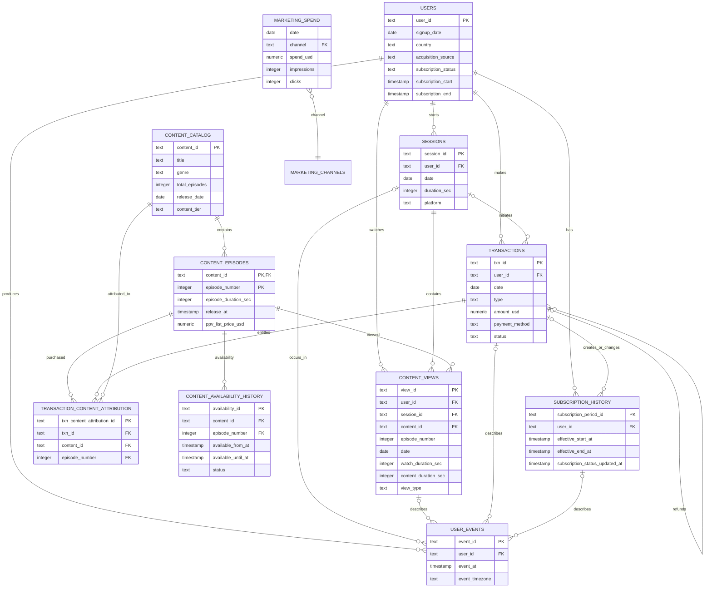

# PocketToons Reference Data Model v1 — Step 2A

## 1. PocketToons context

PocketToons is the fictional anime-streaming product in the interview assignment. It uses a freemium model: every user can start eight free episodes per UTC calendar day; a $9.99 monthly subscription unlocks all content; and users can also buy individual premium episodes through pay-per-view (PPV). The assignment asks for six months of synthetic data and an analytics agent that can investigate questions such as: **MAU is up 20% quarter-over-quarter, but revenue is flat—why?**

This document is the data blueprint for that PocketToons case. It keeps the six tables and fields required by the assignment, then adds only the relationships needed to tell a complete customer story: sessions, episodes watched, paywall behavior, PPV purchases, subscriptions, cancellations, refunds, and the timing between each action.

PocketToons is a concrete reference module inside a broader, generalized product-analytics-agent repository. The reusable agent architecture and shared analytics conventions will live in their own documentation later; this model gives those components one realistic product dataset to work against.

## 2. Design decisions

The model must preserve both the *business state* (current subscription) and the *history that created it* (events, subscription periods, transactions, and watched episodes).

The six assignment tables and their required fields are retained exactly, with additive fields where necessary. `users.subscription_status`, `subscription_start`, and `subscription_end` are a convenient current-state snapshot; `subscription_history` is authoritative for historical/as-of entitlement. Likewise, `content_views` is a view fact rather than a session summary, and `session_id` makes every in-app view joinable to the session in which it occurred.

### Entity relationship diagram



`MARKETING_CHANNELS` is a controlled-value reference, shown only to make the `marketing_spend.channel` relationship explicit. It is optional in an initial SQLite build; a checked enum can enforce the same contract.

## 3. Canonical keys, time, and access rules

### IDs and timestamps

- IDs are immutable opaque strings (for example, UUIDs); do not infer a timestamp, country, or source from an ID.
- Store all event timestamps in UTC as ISO-8601 timestamps. Assignment-mandated `date` fields are UTC calendar dates derived from the canonical timestamp, retained for simple daily analysis.
- The v1 free quota resets at 00:00 UTC for everyone. This is a chosen product rule for the synthetic case; it means the reset occurs at different local clock times. Event timezone is retained as context for later local-time analysis, not used to calculate this quota.
- Assignment-required date fields are derived compatibility fields; raw event timestamps remain the source of truth. A daily marketing report retains its source reporting date and must be explicitly normalized to UTC only if its source supports it.
- `users` is one row per user. Facts are append-only except for documented correction fields; no facts are overwritten to represent a new business event.

### Entitlement precedence at a view start

1. An active subscription period wins (`view_type = 'sub'`).
2. Otherwise, a successful non-refunded PPV entitlement for that exact `content_id + episode_number` wins (`'ppv'`).
3. Otherwise, an eligible episode among the user’s first eight distinct free episodes that UTC day is `'free'`.
4. Any other premium playback must be blocked and recorded as a `playback_blocked` event, not as a `content_views` row.

A retry or resume of the same episode on the same UTC day does not consume another slot. A new UTC day starts a new quota; free access to a previously watched episode is subject to that day's quota unless the user has another entitlement.

Active subscribers pay no PPV charge for viewing. A PPV purchase remains valid if the user later subscribes; no automatic credit is assumed. A refund request is an event; a succeeded refund creates a linked negative transaction and ends the relevant access at its effective time. A denied refund leaves access unchanged. Views already recorded are retained.

The stored `content_views.view_type` records the decision at view start and is never retroactively relabelled by a later cancellation/refund. Recalculated “as-of” access must use the history tables below.

## 4. Column-level schema and grain

### 4.1 `users` — assignment-mandated

**Grain:** one row per registered user. **Primary key:** `user_id`.

| Column | Type | Null? | Definition / rule |
|---|---|---:|---|
| `user_id` | TEXT | no | Immutable primary key. |
| `signup_date` | DATE | no | Assignment-required UTC date derived from `signup_at`. |
| `signup_at` | TIMESTAMP | no | UTC account-creation timestamp. |
| `country` | TEXT | no | ISO-3166-1 alpha-2 country at signup/current profile state; controlled list. |
| `acquisition_source` | TEXT | no | First-touch channel (`organic`, `paid_search`, `paid_social`, `creator`, `referral`, `other`). |
| `subscription_status` | TEXT | no | Current snapshot: `never_subscribed`, `active`, `cancel_at_period_end`, `expired`, `refunded`, `paused`. Not for historical entitlement. |
| `subscription_start` | TIMESTAMP | yes | Start of the current/latest subscription period; NULL if never subscribed. |
| `subscription_end` | TIMESTAMP | yes | End of current/latest subscription period; NULL if unknown or never subscribed. |
| `created_at` | TIMESTAMP | no | Record creation timestamp. |
| `updated_at` | TIMESTAMP | no | Snapshot update timestamp, not a subscription-specific change time. |

A never-subscribed user has `subscription_status = 'never_subscribed'` and NULL subscription start/end. NULL means no value, not an empty string. The subscription-status change timestamp belongs to `subscription_history`.

### 4.2 `sessions` — assignment-mandated

**Grain:** one contiguous authenticated or anonymous-to-authenticated app visit per user/device. **Primary key:** `session_id`. **Foreign key:** `user_id → users.user_id`.

| Column | Type | Null? | Definition / rule |
|---|---|---:|---|
| `session_id` | TEXT | no | Immutable primary key. |
| `user_id` | TEXT | no | User who owned the session. |
| `date` | DATE | no | UTC date of `session_started_at` (assignment field). |
| `duration_sec` | INTEGER | no | `session_ended_at - session_started_at`, non-negative. |
| `platform` | TEXT | no | `ios`, `android`, `web`, `tv`; controlled list. |
| `session_started_at` | TIMESTAMP | no | UTC session start. |
| `session_ended_at` | TIMESTAMP | no | UTC session end; must be >= start. |
| `device_id_hash` | TEXT | yes | Privacy-safe device identifier; not an identity key. |
| `app_version` | TEXT | yes | Client version at session start. |
| `country_at_event` | TEXT | yes | Country captured at session start for temporal analysis. |

### 4.3 `content_catalog` — assignment-mandated

**Grain:** one series/title; individual episodes are in `content_episodes`. **Primary key:** `content_id`.

| Column | Type | Null? | Definition / rule |
|---|---|---:|---|
| `content_id` | TEXT | no | Title/series primary key. |
| `title` | TEXT | no | Display title. |
| `genre` | TEXT | no | Primary genre. |
| `total_episodes` | INTEGER | no | Positive count of published and planned episode records. |
| `release_date` | DATE | no | Assignment-required UTC date derived from `first_release_at`. |
| `first_release_at` | TIMESTAMP | no | UTC first episode release timestamp. |
| `last_release_at` | TIMESTAMP | yes | UTC most recent released episode timestamp, when known. |
| `total_duration_sec` | INTEGER | no | Derived sum of durations across all published and planned episode records; refresh when episodes change. |
| `content_tier` | TEXT | no | Default commercial tier: `free`, `premium`, `mixed`. |
| `content_status` | TEXT | no | Current title status: `scheduled`, `live`, `delisted`, `archived`. |
| `available_from_at` | TIMESTAMP | yes | UTC start of current/latest title availability. |
| `available_until_at` | TIMESTAMP | yes | UTC exclusive end of current/latest title availability; NULL while open. |
| `created_at` | TIMESTAMP | no | Catalog record timestamp. |
| `updated_at` | TIMESTAMP | no | Last catalog correction timestamp. |

### 4.3a `content_episodes` — episode-level catalog

**Grain:** one episode within one title. **Primary key:** (`content_id`, `episode_number`); `content_id → content_catalog`. Views and PPV attribution reference this composite key.

| Column | Type | Null? | Definition / rule |
|---|---|---:|---|
| `content_id` | TEXT | no | Parent series. |
| `episode_number` | INTEGER | no | Positive episode number, unique within the series. |
| `episode_title` | TEXT | yes | Episode title if supplied. |
| `episode_duration_sec` | INTEGER | no | Positive episode duration. |
| `release_at` | TIMESTAMP | no | UTC release timestamp. |
| `available_from_at` | TIMESTAMP | yes | UTC start of current/latest availability. |
| `available_until_at` | TIMESTAMP | yes | UTC exclusive availability end; NULL while open. |
| `episode_status` | TEXT | no | Current status: `scheduled`, `live`, `delisted`, `archived`. |
| `access_tier` | TEXT | no | `free` or `premium`; subscription unlocks both; free quota applies to eligible episodes. |
| `ppv_list_price_usd` | NUMERIC(12,2) | yes | Current list price for PPV-eligible premium episodes; default $1.99 in v1, NULL when not offered. The transaction retains the price charged at purchase. |

### 4.3b `content_availability_history` — historical availability

**Grain:** one effective availability/status interval for an episode. **Primary key:** `availability_id`; composite FK (`content_id`, `episode_number`) → `content_episodes`. A title removal closes the relevant episode intervals. Re-listing creates new intervals; no historical views are deleted.

| Column | Type | Null? | Definition / rule |
|---|---|---:|---|
| `availability_id` | TEXT | no | Immutable identifier. |
| `content_id` | TEXT | no | Series ID. |
| `episode_number` | INTEGER | no | Episode within series. |
| `available_from_at` | TIMESTAMP | no | UTC inclusive interval start. |
| `available_until_at` | TIMESTAMP | yes | UTC exclusive interval end; NULL for an open interval. |
| `status` | TEXT | no | `scheduled`, `live`, `delisted`, or `archived` for the interval. |
| `recorded_at` | TIMESTAMP | no | UTC time the state was recorded. |

### 4.4 `content_views` — assignment-mandated, session-linked

**Grain:** one playback attempt that passes entitlement and reaches a measurable start; a resume in a later session is another row. **Primary key:** `view_id`. **Foreign keys:** `user_id → users`, `session_id → sessions`, and (`content_id`, `episode_number`) → `content_episodes`.

| Column | Type | Null? | Definition / rule |
|---|---|---:|---|
| `view_id` | TEXT | no | Immutable primary key. |
| `user_id` | TEXT | no | Viewer; must equal the session's user. |
| `content_id` | TEXT | no | Series/title viewed. |
| `episode_number` | INTEGER | no | 1..`content_catalog.total_episodes`. |
| `date` | DATE | no | UTC date of `view_started_at` (assignment field). |
| `watch_duration_sec` | INTEGER | no | Seconds watched in this attempt; 0..`content_duration_sec`. |
| `content_duration_sec` | INTEGER | no | Episode length at playback; > 0. |
| `view_type` | TEXT | no | Entitlement at start: `free`, `sub`, `ppv`. |
| `session_id` | TEXT | no | Session containing the view. |
| `view_started_at` | TIMESTAMP | no | UTC playback-start time. |
| `view_ended_at` | TIMESTAMP | yes | UTC end; null only for an interrupted/incomplete event. |
| `completion_pct` | NUMERIC | no | Derived/stored: `watch_duration_sec / content_duration_sec`, 0..1. |
| `playback_position_start_sec` | INTEGER | no | Resume position, >= 0. |
| `playback_position_end_sec` | INTEGER | no | End position, >= start. |
| `is_first_view_of_episode` | BOOLEAN | no | First valid view by that user for the title/episode, computed at ingestion. |
| `free_quota_consuming` | BOOLEAN | no | True only for the first free view of this episode by this user on the UTC day; retries/resumes are false. |
| `free_quota_sequence` | INTEGER | yes | Slot 1–8 for a consuming free view; NULL otherwise. |
| `event_timezone` | TEXT | yes | IANA timezone reported at event time, when known; context only. |

### 4.5 `transactions` — assignment-mandated

**Grain:** one immutable payment-provider financial event. A subscription renewal, PPV charge, or refund is its own row. **Primary key:** `txn_id`. **Foreign key:** `user_id → users`; `session_id → sessions` when in-app initiated.

| Column | Type | Null? | Definition / rule |
|---|---|---:|---|
| `txn_id` | TEXT | no | Immutable primary key. |
| `user_id` | TEXT | no | Purchaser/refund recipient. |
| `date` | DATE | no | UTC date of `transaction_at` (assignment field). |
| `type` | TEXT | no | `subscription`, `ppv`, `refund`. |
| `amount_usd` | NUMERIC(12,2) | no | Signed ledger amount: charge > 0; refund < 0. |
| `payment_method` | TEXT | no | `apple_app_store`, `google_play`, `credit_debit_card`, `paypal`, `wallet`, `other`. |
| `status` | TEXT | no | State of this payment event: `pending`, `succeeded`, `failed`, `voided`. A successful refund is a separate succeeded negative row. |
| `transaction_subtype` | TEXT | no | `subscription_initial`, `subscription_renewal`, `ppv_episode_purchase`, `subscription_refund`, `ppv_refund`. |
| `payment_provider` | TEXT | no | Provider processing the payment. |
| `list_price_usd` | NUMERIC(12,2) | yes | Listed price at purchase, before discount. |
| `discount_usd` | NUMERIC(12,2) | yes | Non-negative discount at purchase. |
| `transaction_at` | TIMESTAMP | no | UTC provider-event time. |
| `session_id` | TEXT | yes | In-app initiating session; null for external renewal/support refund. |
| `provider_transaction_id` | TEXT | no | Unique provider id / idempotency key. |
| `currency` | TEXT | no | Original ISO currency; v1 synthetic data uses `USD`. |
| `original_amount` | NUMERIC(12,2) | no | Amount in original currency before USD normalization. |
| `related_txn_id` | TEXT | yes | Original charge for a refund; self-FK to `transactions.txn_id`. |
| `subscription_id` | TEXT | yes | Logical subscription identifier for subscription charges or related refunds. |

### 4.6 `marketing_spend` — assignment-mandated

**Grain:** one UTC calendar day × paid marketing channel. **Natural key:** (`date`, `channel`). This table attributes acquisition, not view/revenue events.

| Column | Type | Null? | Definition / rule |
|---|---|---:|---|
| `date` | DATE | no | Spend date. |
| `channel` | TEXT | no | Paid channel; controlled list shared with acquisition mapping. |
| `spend_usd` | NUMERIC(12,2) | no | Non-negative daily spend. |
| `impressions` | INTEGER | no | Non-negative delivered impressions. |
| `clicks` | INTEGER | no | 0..`impressions`. |
| `campaign_id` | TEXT | yes | Optional campaign identifier; add to the natural key if populated. |
| `country` | TEXT | yes | Geo where spend was targeted; null means all markets. |
| `loaded_at` | TIMESTAMP | no | Ingestion/audit time. |

### 4.7 `subscription_history` — supporting, authoritative entitlement timeline

**Grain:** one non-overlapping effective period for a `subscription_id`; split a period whenever entitlement/status changes. **Primary key:** `subscription_period_id`. **Foreign keys:** `user_id → users`, `source_txn_id → transactions`.

| Column | Type | Null? | Definition / rule |
|---|---|---:|---|
| `subscription_period_id` | TEXT | no | Primary key. |
| `subscription_id` | TEXT | no | Logical subscription across renewals. |
| `user_id` | TEXT | no | Entitled user. |
| `effective_start_at` | TIMESTAMP | no | UTC inclusive start of the access/status interval. |
| `subscription_status_updated_at` | TIMESTAMP | no | UTC time the status change took effect; equals `effective_start_at` for status changes. |
| `effective_end_at` | TIMESTAMP | yes | Exclusive end; null only while open. |
| `status` | TEXT | no | `active`, `cancel_at_period_end`, `cancelled`, `expired`, `paused`, `refunded`. |
| `plan_code` | TEXT | no | `monthly_9_99` in v1; extensible. |
| `source_txn_id` | TEXT | yes | Charge/refund that created this state. |
| `cancelled_at` | TIMESTAMP | yes | Cancellation request time, distinct from end of access. |
| `recorded_at` | TIMESTAMP | no | Warehouse knowledge time for late-arrival audit. |

### 4.8 `transaction_content_attribution` — supporting PPV entitlement bridge

**Grain:** one transaction × content title × episode entitlement. It resolves PPV to the episode actually bought and permits future bundles without duplicating transaction money. **Primary key:** `txn_content_attribution_id`. **Foreign keys:** `txn_id → transactions`, and (`content_id`, `episode_number`) → `content_episodes`.

| Column | Type | Null? | Definition / rule |
|---|---|---:|---|
| `txn_content_attribution_id` | TEXT | no | Primary key. |
| `txn_id` | TEXT | no | The original `type='ppv'` purchase. Refunds link to it via `transactions.related_txn_id`. |
| `content_id` | TEXT | no | Entitled series/title. |
| `episode_number` | INTEGER | no | Entitled episode. |
| `entitlement_start_at` | TIMESTAMP | no | Inclusive access start. |
| `entitlement_end_at` | TIMESTAMP | yes | Exclusive end; null for perpetual v1 PPV access. |
| `attributed_amount_usd` | NUMERIC(12,2) | no | Purchase allocation; sum equals the completed PPV charge. Refund allocations require an explicit policy and cannot be inferred for bundles. |
| `attribution_status` | TEXT | no | Current state: `granted`, `revoked`, `refunded`. Historical queries use effective timestamps rather than current status alone. |
| `refunded_at` | TIMESTAMP | yes | UTC effective timestamp when entitlement was revoked after refund. |

### 4.9 `user_events` — supporting interaction timeline

**Grain:** one client/server business event, append-only. **Primary key:** `event_id`. This is the complete timeline for behavior that is not itself a view or financial fact; it does *not* replace the fact tables.

| Column | Type | Null? | Definition / rule |
|---|---|---:|---|
| `event_id` | TEXT | no | Immutable primary key / idempotency key. |
| `user_id` | TEXT | no | Actor. |
| `event_at` | TIMESTAMP | no | UTC event time. |
| `event_timezone` | TEXT | yes | IANA timezone reported at event time, if known; timestamps remain UTC. |
| `event_name` | TEXT | no | Controlled event, e.g. `app_opened`, `episode_detail_viewed`, `paywall_viewed`, `checkout_started`, `subscription_cancel_requested`, `playback_blocked`. |
| `session_id` | TEXT | yes | Null only for server/background/support events. |
| `view_id` | TEXT | yes | View described, if applicable. |
| `txn_id` | TEXT | yes | Transaction described, if applicable. |
| `subscription_period_id` | TEXT | yes | Subscription state described, if applicable. |
| `content_id` | TEXT | yes | Relevant title. |
| `episode_number` | INTEGER | yes | Relevant episode. |
| `event_properties_json` | TEXT | yes | Versioned, non-metric context; no PII or fields needed for core reporting. |
| `ingested_at` | TIMESTAMP | no | Warehouse arrival time. |

## 5. Relationship cardinality and referential rules

| Parent | Child | Cardinality | Required? | Rule |
|---|---|---|---|---|
| `users` | `sessions` | 1 : 0..N | child yes | Each session belongs to exactly one user. |
| `sessions` | `content_views` | 1 : 0..N | child yes | Every valid view is within exactly one session. |
| `users` | `content_views` | 1 : 0..N | child yes | Must match `sessions.user_id`. |
| `content_catalog` | `content_episodes` | 1 : 0..N | child yes | Episodes belong to one title. |
| `content_episodes` | `content_views` | 1 : 0..N | child yes | Composite key identifies the exact episode. |
| `content_episodes` | `transaction_content_attribution` | 1 : 0..N | child yes | Composite key identifies the purchased episode. |
| `content_episodes` | `content_availability_history` | 1 : 0..N | child yes | Records availability over time. |
| `users` | `transactions` | 1 : 0..N | child yes | Each money event has one economic user. |
| `sessions` | `transactions` | 1 : 0..N | child optional | Null for renewals/refunds outside an app session. |
| `transactions` | `transaction_content_attribution` | 1 : 0..N | PPV only | A single PPV may be one episode or a future bundle. |
| `users` | `subscription_history` | 1 : 0..N | child yes | A user can churn and resubscribe. |
| `transactions` | `subscription_history` | 1 : 0..N | child optional | State may come from support/system action. |
| `users` | `user_events` | 1 : 0..N | child yes | Timeline preserves all modeled interaction types. |

## 6. Temporal / as-of logic

Use half-open intervals: `effective_start_at <= as_of_ts AND (effective_end_at > as_of_ts OR effective_end_at IS NULL)`. This eliminates boundary double-counting.

**Subscription as of a view:** choose at most one `subscription_history` row for the user containing `content_views.view_started_at` and with access-granting status (`active` or `cancel_at_period_end`). A cancellation event changes the status but does not remove access before `effective_end_at`; a refund can close/revoke access according to its effective timestamp.

**PPV as of a view:** choose a `transaction_content_attribution` row matching `content_id`, `episode_number`, and the view start interval, with a grant effective at view time; join to a succeeded purchase. Use `entitlement_end_at` or `refunded_at` as an exclusive cutoff: a later refund must not erase entitlement before its effective time. PPV access has no time expiry in v1, but is usable only while the episode is live and is revoked if its refund succeeds.

**Current snapshot:** derive `users.subscription_*` from the state effective at the snapshot time using records known at the reporting cutoff, rather than using it to answer a past question. Late-arriving provider events are recorded with both `event_at/effective_*` and `recorded_at`; reports state their run/as-of time.

## 7. Fanout-safe joins and metric rules

Facts have different grains. Never join several one-to-many children and aggregate money/duration afterwards.

| Question / metric | Safe driving grain | Safe pattern | Avoid |
|---|---|---|---|
| Revenue by user/day | `transactions` | Filter to succeeded economic rows, aggregate by `txn_id` first; refunds are signed reversals. | Joining transactions directly to views/events. |
| PPV revenue by episode | attribution | Allocate `attributed_amount_usd` after validating allocation once per `txn_id`; aggregate bridge, not transaction amount. | Repeating `transactions.amount_usd` once per attribution row. |
| Watch time by session | `content_views` | Aggregate views to `session_id`, then join session attributes. | Joining session to transaction/event detail then summing watch time. |
| Conversion after view | eligible view cohort | Create one row per qualifying `view_id`, then attach the first subsequent transaction with a window/ranked subquery. | Joining every view to every later transaction. |
| User journey | ordered event spine | `UNION ALL` normalized facts/events, ordered by timestamp; preserve source type/id. | Joining all child tables side-by-side. |

All reporting joins must state their intended grain and validate `COUNT(DISTINCT primary_key) = COUNT(primary_key)` after any expected many-to-one lookup. Pre-aggregate each child fact to the reporting grain before combining it with another child fact.

## 8. Example journey joins

### Journey A — two sessions, viewing, PPV purchase, then cancellation

1. User `U1` watches episode 9 in session `S1` at 09:00. `content_views(V1)` links to `S1`, `U1`, title A, episode 9, and has `view_type='free'`.
2. At 20:00, `U1` returns in `S2`, watches episodes 10 and 11 (`V2`, `V3`).
3. In `S2`, `U1` views a paywall, starts checkout, and purchases episode 12. `user_events` records those UI moments; `transactions(T1)` is a successful PPV charge with `session_id='S2'`; `transaction_content_attribution(A1)` entitles title A/episode 12.
4. `U1` watches episode 12 in `S2`; `V4.view_type='ppv'` is validated as-of `V4.view_started_at` using `A1` and `T1`.
5. Later, `U1` starts a subscription (`T2`), creating `subscription_history(P1)`. A later cancellation request emits `user_events` and creates a successor subscription period/status; access stays valid through the paid period end.

A journey query should normalize sources to: `(user_id, occurred_at, source, source_id, session_id, content_id, episode_number, txn_id, subscription_period_id)`, then `UNION ALL` and order. This preserves sequence without multiplying V2/V3/V4 by T1/T2.

```sql
-- As-of PPV validation for one view; one entitlement row at most.
SELECT v.view_id, t.txn_id
FROM content_views v
JOIN transaction_content_attribution a
  ON a.content_id = v.content_id
 AND a.episode_number = v.episode_number
 AND a.entitlement_start_at <= v.view_started_at
 AND (a.entitlement_end_at > v.view_started_at OR a.entitlement_end_at IS NULL)
 AND (a.refunded_at > v.view_started_at OR a.refunded_at IS NULL)

JOIN transactions t ON t.txn_id = a.txn_id AND t.type = 'ppv'
WHERE v.view_id = :view_id AND t.user_id = v.user_id AND t.status = 'succeeded';
```

### Journey B — viewing in one session, subscription later in another

If a user watches free episode 8 at 08:00 in `S1`, exits, and subscribes at 21:00 in `S2`, do not assign the subscription to `S1`. The conversion funnel can link `V1 → T1` only through an explicitly defined attribution window (for example, the first succeeded subscription within seven days), and must retain both `view_session_id` and `purchase_session_id`.

## 9. Data integrity and acceptance tests

These tests are requirements for the future generator/loader, not implementation in this step.

| Test | Assertion |
|---|---|
| Primary-key uniqueness | Every declared PK has zero duplicates and zero nulls. |
| FK coverage | All non-null foreign keys resolve to exactly one parent. |
| View/session ownership | `content_views.user_id = sessions.user_id` for every view. |
| Session chronology | `session_ended_at >= session_started_at`; `duration_sec` equals their difference within an allowed rounding tolerance. |
| View chronology | View start/end lies within or touches session bounds by an allowed client-clock tolerance. |
| Episode validity | Every view/attribution composite episode key resolves to `content_episodes`. |
| Content availability | Every view begins within a live availability interval; history intervals for an episode do not overlap. |
| UTC consistency | Event timestamps have UTC offsets; required dates equal their source timestamp's UTC date. |
| Status history | Subscription status change timestamps are in `subscription_history`; current snapshot reconciles to the status effective now. |
| Playback bounds | `0 <= watch_duration_sec <= content_duration_sec`; completion is in [0,1]. |
| Subscription non-overlap | No overlapping effective intervals for the same `subscription_id`; at most one access-granting period per user at an instant. |
| Snapshot reconciliation | `users.subscription_*` matches the latest relevant subscription-history state. |
| PPV uniqueness | A granted PPV entitlement maps to one specific title/episode; no duplicate active entitlement for the same user/episode unless explicitly modeled as a replacement. |
| PPV financial reconciliation | For each succeeded PPV transaction, attribution allocations sum to its amount once (or an explicit allocation policy documents a residual). |
| Refund linkage | Each refund has `related_txn_id`, references a prior succeeded charge of the same user, and has a negative amount. |
| Entitlement correctness | Every `view_type='sub'` has an access-granting subscription as of view start; every `'ppv'` has an active successful PPV entitlement; every `'free'` obeys the first-eight UTC-day rule. |
| Free-cap test | No user has more than eight quota-consuming distinct episodes per UTC day; retries/resumes of an episode on the same UTC day do not consume another slot. |
| Transaction/session consistency | If `transactions.session_id` is present, it belongs to the same `user_id`; null is permitted only for documented off-session flows. |
| Event reference consistency | Each populated event reference (`view_id`, `txn_id`, `subscription_period_id`) exists and belongs to `user_events.user_id`. |
| Marketing plausibility | `spend_usd >= 0`, `impressions >= 0`, and `0 <= clicks <= impressions`; daily channel key is unique. |
| Join fanout regression | Joining a transaction to its attribution bridge must not change total transaction revenue when aggregating distinct transaction IDs; session-view joins must retain one row per `view_id`. |

## 10. Implementation boundary for later stages

This document intentionally stops before implementation. The next stage will translate this contract into SQLite DDL, deterministic synthetic-data generation, and test queries. It will plant the assignment’s coherent business story and at least one visible data-quality issue **without changing this model’s stated grain, keys, or mandatory fields**.
